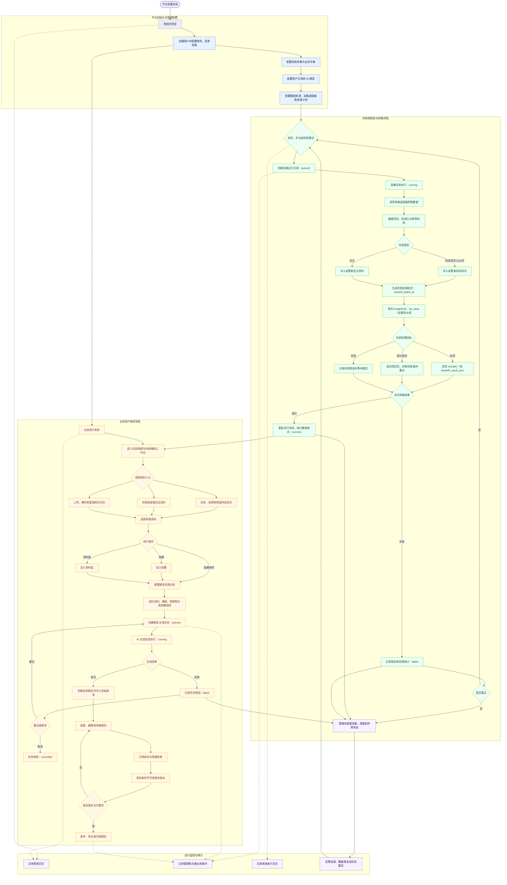
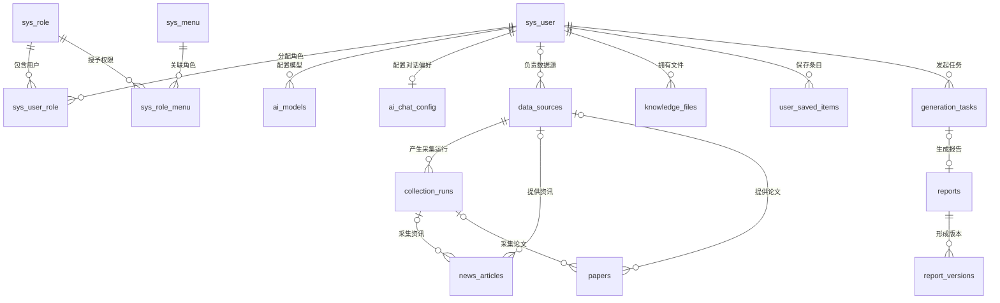

# PipeSight 数据库技术对接说明书

> 文档版本：V1.0  
> 文档状态：技术对接基线  
> 编制日期：2026-08-17  
> 适用系统：国家管网科技情报与科研辅助平台（PipeSight）  
> 适用数据库：MySQL 8.0+、PostgreSQL 14+

## 文档修订记录

| 版本 | 日期 | 修订内容 | 状态 |
|---|---|---|---|
| V1.0 | 2026-08-17 | 建立全系统 23 表数据库技术对接基线 | 待双方确认 |
| V1.1 | 2026-08-24 | 增加 InsightHub 外部处理交接字段和跨系统流程 | 待双方确认 |

## 1. 文档目的

本文档用于 PipeSight 与外部研发、数据库、数据采集及系统集成团队进行技术对接，统一以下内容：

- 数据库建设范围和数据域划分；
- 表职责、主键、核心字段和唯一性约束；
- 表间关系、外键及删除策略；
- 状态值、JSON 快照和数据生命周期约定；
- 数据库初始化、升级和联调验收要求。

本系统与 InsightHub 的采集后处理边界见 [PipeSight-InsightHub 数据交接适配说明](交接文档/PipeSight-InsightHub-数据交接适配说明.md)。

字段长度、默认值、索引名称及数据库方言差异，以随系统交付的 SQL 脚本和 Alembic 迁移为最终执行依据。

## 2. 建设范围

### 2.1 数据库组成

系统采用单一应用数据库，当前基线共包含 23 张应用表。

| 数据域 | 表数 | 主要职责 |
|---|---:|---|
| 账号与权限 | 5 | 用户、角色、菜单和 RBAC 授权 |
| 平台配置、日志与调度 | 7 | 参数、字典、登录日志、操作审计和定时任务 |
| AI 配置 | 2 | 用户级模型配置和 AI 对话偏好 |
| 采集与内容 | 4 | 数据源、采集运行、科技资讯和论文 |
| 知识与报告 | 5 | 知识文件、收藏/资料篮、报告生成任务、报告和版本 |
| **合计** | **23** | PipeSight 当前完整数据库范围 |

### 2.2 不在本期范围内的数据库对象

以下能力不属于当前系统数据库范围，外部系统不得依赖相关表或字段：

- 部门树、部门数据权限和用户部门关联；
- 岗位字典和用户岗位关联；
- 站内通知公告；
- 在线代码生成配置；
- 内容切块、向量索引、独立提示词版本、独立报告模板；
- AI 单次调用流水和通用业务审计表。

对应表包括但不限于：`sys_dept`、`sys_post`、`sys_role_dept`、`sys_user_post`、`sys_notice`、`gen_table`、`gen_table_column`、`knowledge_chunks`、`report_templates`、`prompt_versions`、`model_calls`、`audit_logs`。

### 2.3 外部处理边界

PipeSight 不复制 InsightHub 的 `hp_news`、`hp_data_source`、`hp_domain`、`hp_topic`、`sys_prompt_version`、`news_prompt_usage` 或 `news_embedding`。采集后的资讯和论文先落入本系统，再通过 `handoff_*` 字段提交、跟踪和接收外部处理结果；外部结果以 `handoff_result_json` 保存原始快照，避免建立第二套同义事实表。

## 3. 平台完整使用流程

### 3.1 端到端流程图



### 3.2 参与角色

| 角色 | 主要职责 |
|---|---|
| 系统管理员 | 用户与角色授权、菜单配置、系统参数、AI 模型、数据来源和调度任务管理 |
| 情报/科研用户 | 资讯与论文检索、知识文件管理、收藏与资料篮、报告生成和编辑 |
| 采集调度服务 | 按计划或人工指令创建运行记录并执行采集 |
| 外部处理系统（InsightHub） | 接收采集后的资讯/论文，完成领域、分类、Prompt、风险和向量处理，并返回版本化结果 |
| AI 生成服务 | 读取任务快照，完成内容生成、引用整理和质量检查 |
| 运维人员 | 监控登录、操作、调度、采集和生成任务，处理异常与重试 |

### 3.3 流程与数据落库映射

| 流程阶段 | 主要读写表 | 数据结果 |
|---|---|---|
| 用户登录与授权 | `sys_user`、`sys_role`、`sys_menu`、`sys_user_role`、`sys_role_menu` | 完成身份认证和功能权限判定 |
| 平台参数配置 | `sys_config`、`sys_dict_type`、`sys_dict_data` | 形成平台运行参数和业务字典 |
| AI 能力配置 | `ai_models`、`ai_chat_config` | 形成用户可使用的模型和对话偏好 |
| 数据来源配置 | `data_sources`、`sys_job` | 形成采集来源、适配器和执行计划 |
| 采集任务执行 | `collection_runs`、`sys_job_log` | 保存运行状态、统计、错误和断点 |
| 资讯与论文入库 | `news_articles`、`papers` | 先保存采集结果，再通过 `handoff_*` 提交外部处理并保存回执 |
| 外部处理回写 | `collection_runs`、`news_articles`、`papers` | 保存批次状态、外部记录 ID、Prompt 追踪 ID、处理版本和结果快照 |
| 知识文件管理 | `knowledge_files` | 保存文件属性、解析状态、摘要和全文 |
| 收藏与资料篮 | `user_saved_items` | 保存用户选材结果和展示快照 |
| 报告生成 | `generation_tasks`、`ai_models` | 固化输入资料并记录生成阶段和日志 |
| 报告创建与编辑 | `reports` | 保存当前可编辑报告内容 |
| 报告版本管理 | `report_versions` | 保存不可变历史版本、引用和模型快照 |
| 登录与操作审计 | `sys_logininfor`、`sys_oper_log` | 保存安全审计和业务操作记录 |

## 4. 总体设计约定

### 4.1 命名约定

- 表名和字段名统一使用小写字母与下划线；
- 平台表沿用 `sys_*`、`ai_*` 命名；
- 业务表使用可直接表达业务职责的复数名词；
- 主键、唯一索引、普通索引和外键分别采用 `pk_`、`uk_`、`idx_`、`fk_` 前缀；
- 不使用无明确含义的通用表名保存多类业务实体。

### 4.2 主键约定

- 平台基础数据和内部明细使用 `BIGINT` 主键；
- 对外展示或跨接口传递的业务对象使用 `VARCHAR(64)` ID；
- `sys_user_role`、`sys_role_menu` 使用业务复合主键；
- 业务编码不能替代主键，但应根据幂等需要设置唯一约束。

### 4.3 字符集、时间和布尔值

- MySQL 字符集使用 `utf8mb4`；
- PostgreSQL 使用 UTF-8 数据库编码；
- 数据库时间字段使用 `DATETIME/TIMESTAMP` 对应类型；
- 服务间传输时间必须使用 ISO 8601 格式并明确时区；
- MySQL 与 PostgreSQL 的布尔类型差异由 ORM 和方言 SQL 处理，接口统一使用 `true/false`。

### 4.4 JSON 字段约定

JSON 仅保存不需要独立关联查询的配置、快照或扩展信息，包括：

- 数据源配置、运行配置快照和采集断点；
- 文件标签、解析元数据和内容扩展属性；
- 任务配置、资料快照、阶段信息和执行日志；
- 报告章节、引用、质量问题及模型快照。

同一业务事实只允许存在一个权威来源：

- 任务选材以 `generation_tasks.selected_items` 为准；
- 当前报告引用以 `reports.citations` 为准；
- 历史版本引用以 `report_versions.citations` 为准。

## 5. 数据表清单

### 5.1 账号与权限

| 表名 | 主键 | 主要职责 | 核心约束 |
|---|---|---|---|
| `sys_user` | `user_id` | 用户账号、认证资料和基础个人信息 | `user_name` 唯一；状态和删除标志受约束 |
| `sys_role` | `role_id` | RBAC 角色定义 | `role_name`、`role_key` 分别唯一 |
| `sys_menu` | `menu_id` | 菜单、目录、按钮及权限标识 | 按父菜单、排序、状态和权限标识建立索引 |
| `sys_user_role` | `(user_id, role_id)` | 用户与角色关系 | 用户或角色删除时级联清理 |
| `sys_role_menu` | `(role_id, menu_id)` | 角色与菜单关系 | 角色或菜单删除时级联清理 |

数据权限只支持：

- `1`：全部数据；
- `5`：仅本人数据。

系统不按部门划分数据权限。`sys_user` 和 `sys_role` 使用软删除，已删除记录的用户名、角色名称和角色编码不允许重新占用。

### 5.2 平台配置、日志与调度

| 表名 | 主键 | 主要职责 | 核心约束 |
|---|---|---|---|
| `sys_config` | `config_id` | 系统参数配置 | `config_key` 唯一 |
| `sys_dict_type` | `dict_id` | 字典类型 | `dict_type` 唯一 |
| `sys_dict_data` | `dict_code` | 字典值 | `(dict_type, dict_value)` 唯一 |
| `sys_logininfor` | `info_id` | 登录成功、失败及终端信息 | 按状态和登录时间建立索引 |
| `sys_oper_log` | `oper_id` | 管理操作及业务操作审计 | 按业务类型、状态、时间建立索引 |
| `sys_job` | `job_id` | 定时任务定义 | `(job_name, job_group)` 唯一 |
| `sys_job_log` | `job_log_id` | 定时任务执行历史 | 任务删除后 `job_id` 置空，日志继续保留 |

业务操作审计统一写入 `sys_oper_log`。外部系统不得另外建设含义重复的业务审计表。

### 5.3 AI 配置

| 表名 | 主键 | 主要职责 | 核心约束 |
|---|---|---|---|
| `ai_models` | `model_id` | 用户级 AI 供应商和模型配置 | `(user_id, provider, model_code)` 唯一 |
| `ai_chat_config` | `chat_config_id` | 用户级 AI 对话偏好 | `user_id` 唯一 |

`ai_models` 主要字段包括：

- `model_code`、`model_name`、`provider`、`model_type`；
- `base_url`、`api_key`、`max_tokens`、`temperature`；
- `support_reasoning`、`support_images`、`status`；
- `user_id`、排序及审计字段。

安全要求：

- `api_key` 必须加密存储；
- API 响应不得返回完整密钥；
- 日志不得记录密钥、访问令牌或完整认证头；
- 用户删除时，其 AI 模型配置和对话偏好级联删除。

## 6. 业务数据字典

### 6.1 `data_sources`——数据来源

保存可执行的数据来源配置。每条记录代表一个独立采集来源。

| 字段 | 类型 | 必填 | 说明 |
|---|---|---:|---|
| `source_id` | `VARCHAR(64)` | 是 | 主键 |
| `source_code` | `VARCHAR(100)` | 是 | 来源编码，全局唯一，用于配置和程序识别 |
| `name` | `VARCHAR(255)` | 是 | 来源名称 |
| `source_type` | `VARCHAR(32)` | 是 | 来源类型 |
| `endpoint` | `VARCHAR(1000)` | 否 | 来源地址或入口地址 |
| `adapter_key` | `VARCHAR(128)` | 是 | 采集适配器标识 |
| `schedule_cron` | `VARCHAR(100)` | 否 | 定时采集表达式 |
| `status` | `VARCHAR(32)` | 是 | 生命周期状态：`active/inactive` |
| `enabled` | `BOOLEAN` | 是 | 是否允许执行采集 |
| `config_json` | `JSON` | 是 | 适配器配置 |
| `last_run_time` | `DATETIME` | 否 | 最近运行时间 |
| `last_run_status` | `VARCHAR(32)` | 否 | 最近运行状态 |
| `success_count` | `INT` | 是 | 累计成功次数，非负 |
| `failure_count` | `INT` | 是 | 累计失败次数，非负 |
| `consecutive_failures` | `INT` | 是 | 连续失败次数，非负 |
| `owner_id` | `BIGINT` | 否 | 负责人，关联 `sys_user.user_id` |
| `create_time` | `DATETIME` | 是 | 创建时间 |
| `update_time` | `DATETIME` | 是 | 更新时间 |

关键索引：`source_code` 唯一索引、`(source_type, status)`、`owner_id`。

外部处理适配字段：`handoff_mode`（`local/external`）和 `processor_source_code`。`processor_source_code` 用于映射对方 `hp_data_source` 的稳定来源编码；为空时默认使用 `source_code`。

### 6.2 `collection_runs`——采集运行记录

保存一次手动、定时或重试采集的执行状态和统计结果。

| 字段 | 类型 | 必填 | 说明 |
|---|---|---:|---|
| `run_id` | `VARCHAR(64)` | 是 | 主键 |
| `source_id` | `VARCHAR(64)` | 是 | 数据来源，关联 `data_sources.source_id` |
| `scheduler_job_id` | `BIGINT` | 否 | 关联调度任务 `sys_job.job_id` |
| `trigger_type` | `VARCHAR(32)` | 是 | `schedule/manual/retry` |
| `status` | `VARCHAR(32)` | 是 | `queued/running/success/failed/cancelled` |
| `config_snapshot` | `JSON` | 是 | 本次执行使用的配置快照 |
| `checkpoint_json` | `JSON` | 是 | 断点及续采信息 |
| `started_at` | `DATETIME` | 否 | 开始时间 |
| `finished_at` | `DATETIME` | 否 | 完成时间 |
| `fetched_count` | `INT` | 是 | 抓取数量，非负 |
| `inserted_count` | `INT` | 是 | 新增数量，非负 |
| `updated_count` | `INT` | 是 | 更新数量，非负 |
| `duplicate_count` | `INT` | 是 | 重复数量，非负 |
| `failed_count` | `INT` | 是 | 失败数量，非负 |
| `error_message` | `TEXT` | 否 | 错误摘要 |
| `create_time` | `DATETIME` | 是 | 创建时间 |
| `update_time` | `DATETIME` | 是 | 更新时间 |

`data_sources` 删除时使用 `RESTRICT`，确保采集运行历史不会失去来源。调度任务删除后 `scheduler_job_id` 使用 `SET NULL`。

外部处理适配字段：`handoff_status`、`handoff_batch_id`、`handoff_count`、`handoff_processed_count`、`handoff_failed_count`、`handoff_time`、`handoff_error`。这些字段只描述本系统向 InsightHub 的交接，不改变采集运行本身的 `status`。

### 6.3 `news_articles`——科技资讯文章

保存科技资讯和微信公众号文章的当前治理结果。

| 字段组 | 主要字段 | 说明 |
|---|---|---|
| 标识 | `article_id`、`article_type` | 主键；类型为 `news/wechat` |
| 标题与地址 | `title`、`canonical_url`、`url_hash` | `url_hash` 唯一，用于 URL 幂等 |
| 来源 | `source_id`、`source_name`、`collection_run_id` | 外键可置空，`source_name` 保存来源快照 |
| 内容 | `author_text`、`summary`、`body` | 作者、摘要和正文 |
| 时间 | `published_time`、`discovered_time` | 发布时间和发现时间 |
| 治理 | `article_hash`、`relevance_score`、`review_status` | 内容哈希唯一；相关性为 `0..100` |
| 权限 | `permission_scope` | `private/public` |
| 扩展 | `tags`、`metadata_json`、`analysis_version` | 标签、元数据和分析版本 |
| 版本 | `version_no`、`create_time`、`update_time` | 当前治理版本及审计时间 |

`review_status` 可选值为 `pending/approved/rejected`。

外部处理适配字段：`handoff_status`、`handoff_batch_id`、`handoff_record_id`、`handoff_trace_id`、`handoff_version`、`handoff_result_json`、`handoff_time`、`handoff_error`。原始外部结果完整保存在 `handoff_result_json`，常用展示字段由服务层按审核规则提升。

### 6.4 `papers`——论文资料

保存论文元数据、摘要、全文可用状态和来源信息。

| 字段组 | 主要字段 | 说明 |
|---|---|---|
| 标识 | `paper_id`、`external_id` | 主键和外部来源标识 |
| 题录 | `title`、`authors`、`authors_json`、`keywords` | 标题、作者及关键词 |
| 唯一标识 | `doi`、`doi_normalized` | 规范化 DOI 唯一 |
| 出版信息 | `journal`、`publisher`、`publication_year`、`volume`、`issue`、`pages` | 年份为空或不早于 1600 |
| 内容 | `abstract_text`、`full_text_url` | 摘要和合法全文地址 |
| 来源 | `source_id`、`source_name`、`collection_run_id`、`canonical_url` | 来源及采集运行 |
| 治理 | `citation_count`、`open_access_status`、`full_text_status`、`review_status` | 引用次数非负 |
| 权限与扩展 | `permission_scope`、`tags`、`metadata_json` | 权限为 `private/public` |
| 审计 | `create_time`、`update_time` | 创建、更新时间 |

`review_status` 可选值为 `pending/approved/rejected`。

论文使用与资讯相同的外部处理字段，保证对方可以统一按 `content_type=news/paper` 回执，PipeSight 不为论文另建处理流水表。

### 6.5 `knowledge_files`——知识库文件

保存用户上传文件、文件属性、解析结果及知识问答使用的全文。

| 字段组 | 主要字段 | 说明 |
|---|---|---|
| 标识 | `file_id`、`name`、`category` | 主键、展示名称和分类 |
| 文件 | `file_name`、`file_path`、`file_url`、`mime_type`、`file_size`、`file_hash` | 文件大小非负 |
| 权限 | `permission_scope`、`allow_download`、`allow_ai_use` | 权限为 `private/public` |
| 解析 | `parse_status`、`parse_message`、`summary`、`extracted_text` | 状态为 `queued/parsing/indexed/failed` |
| 扩展 | `tags`、`metadata_json` | 标签和解析扩展信息 |
| 归属 | `owner_id`、`owner_name` | 所有者关联 `sys_user` |
| 版本 | `version_no`、`create_time`、`update_time` | 版本号至少为 1 |

文件采用物理删除。删除文件记录时，应同时删除受控存储中的文件，并清理对应的 `user_saved_items`。

### 6.6 `user_saved_items`——用户收藏与资料篮

统一保存用户的收藏和资料篮条目。

| 字段 | 类型 | 必填 | 说明 |
|---|---|---:|---|
| `saved_item_id` | `BIGINT` | 是 | 主键 |
| `user_id` | `BIGINT` | 是 | 用户，关联 `sys_user.user_id` |
| `item_id` | `VARCHAR(64)` | 是 | 目标业务对象 ID |
| `item_type` | `VARCHAR(32)` | 是 | `material/article/paper/report` |
| `action` | `VARCHAR(16)` | 是 | `favorite/basket` |
| `title` | `VARCHAR(500)` | 是 | 条目标题快照 |
| `snapshot` | `JSON` | 是 | 展示所需的最小业务快照 |
| `create_time` | `DATETIME` | 是 | 创建时间 |

唯一约束：`(user_id, item_type, item_id, action)`。

该表采用多态业务引用，不对 `item_id` 建立数据库外键。写入前必须由服务层验证目标存在；目标对象删除时必须同步清理关联条目。

### 6.7 `generation_tasks`——报告生成任务

保存报告生成任务的输入、资料快照、执行阶段和日志。

| 字段组 | 主要字段 | 说明 |
|---|---|---|
| 标识与归属 | `task_id`、`user_id`、`owner_name` | 主键及任务发起人 |
| 基本信息 | `title`、`report_type` | 报告标题和类型 |
| 模板快照 | `template_id`、`template_version` | 内置模板编码及版本，不建立模板表外键 |
| 执行状态 | `status`、`current_stage`、`progress` | 状态为 `queued/running/completed/failed/cancelled`；进度为 `0..100` |
| 输入快照 | `config`、`selected_items`、`outline` | 生成配置、资料快照和提纲 |
| 过程信息 | `stages`、`logs`、`error_message` | 阶段、日志和错误摘要 |
| 审计 | `create_time`、`update_time` | 创建、更新时间 |

任务表不保存 `report_id`。任务与报告的关系由 `reports.source_task_id` 单向表达。

### 6.8 `reports`——报告

保存当前可编辑、可发布的报告聚合。

| 字段组 | 主要字段 | 说明 |
|---|---|---|
| 标识与来源 | `report_id`、`source_task_id` | 主键；来源任务唯一 |
| 归属 | `user_id`、`owner_name` | 报告所有者 |
| 基本信息 | `title`、`report_type`、`status` | 状态为 `draft/reviewing/completed/published/archived` |
| 当前内容 | `content`、`sections`、`citations`、`quality_issues` | 当前正文及结构化结果 |
| 扩展 | `metadata_json` | 报告图形、扩展属性等 |
| 统计与版本 | `word_count`、`version_no` | 字数非负，版本号至少为 1 |
| 审计 | `create_time`、`update_time` | 创建、更新时间 |

`source_task_id` 具有唯一约束，保证一个生成任务最多形成一份当前报告。

### 6.9 `report_versions`——报告版本

保存不可变的报告历史版本。

| 字段 | 类型 | 必填 | 说明 |
|---|---|---:|---|
| `report_version_id` | `BIGINT` | 是 | 主键 |
| `report_id` | `VARCHAR(64)` | 是 | 所属报告，关联 `reports.report_id` |
| `version_no` | `INT` | 是 | 报告内版本号，至少为 1 |
| `title` | `VARCHAR(500)` | 是 | 版本标题快照 |
| `content` | `TEXT` | 是 | 版本正文 |
| `sections` | `JSON` | 是 | 章节快照 |
| `citations` | `JSON` | 是 | 引用快照 |
| `quality_issues` | `JSON` | 是 | 质量检查结果快照 |
| `model_snapshot` | `JSON` | 是 | 生成模型和参数快照 |
| `source` | `VARCHAR(32)` | 是 | `generated/retry/manual/autosave/publish/restored` |
| `operator_id` | `BIGINT` | 否 | 操作人，删除用户后置空 |
| `operator_name` | `VARCHAR(64)` | 是 | 操作人名称快照 |
| `create_time` | `DATETIME` | 是 | 版本创建时间 |

唯一约束：`(report_id, version_no)`。报告删除时，其版本记录级联删除。历史版本只新增、不修改。

## 7. 核心关系模型



## 8. 外键和删除策略

| 主对象 | 从对象 | 外键策略 | 对接要求 |
|---|---|---|---|
| 用户 | 用户角色、收藏、AI 配置 | `CASCADE` | 用户删除后附属配置自动清理 |
| 用户 | 知识文件、生成任务、报告 | `RESTRICT` | 删除用户前必须转移或清理业务资产 |
| 数据源 | 采集运行 | `RESTRICT` | 存在采集历史时不得删除来源 |
| 数据源 | 资讯、论文 | `SET NULL` | 内容保留，使用 `source_name` 快照展示来源 |
| 采集运行 | 资讯、论文 | `SET NULL` | 内容不依赖运行记录继续存在 |
| 调度任务 | 采集运行、任务日志 | `SET NULL` | 删除调度定义不删除历史 |
| 生成任务 | 报告 | `SET NULL` | 报告可脱离任务独立保留 |
| 报告 | 报告版本 | `CASCADE` | 删除报告时同步删除全部版本 |

禁止通过关闭数据库外键检查规避数据完整性问题。

## 9. 状态与枚举字典

| 对象/字段 | 允许值 | 说明 |
|---|---|---|
| `sys_role.data_scope` | `1`、`5` | 全部数据、仅本人 |
| `data_sources.status` | `active`、`inactive` | 来源生命周期 |
| `collection_runs.trigger_type` | `schedule`、`manual`、`retry` | 运行触发方式 |
| `collection_runs.status` | `queued`、`running`、`success`、`failed`、`cancelled` | 采集运行状态 |
| `news_articles.article_type` | `news`、`wechat` | 资讯类型 |
| `news_articles.review_status` | `pending`、`approved`、`rejected` | 内容审核状态 |
| `papers.review_status` | `pending`、`approved`、`rejected` | 论文审核状态 |
| `permission_scope` | `private`、`public` | 文件或内容权限范围 |
| `knowledge_files.parse_status` | `queued`、`parsing`、`indexed`、`failed` | 文件解析状态 |
| `user_saved_items.item_type` | `material`、`article`、`paper`、`report` | 收藏目标类型 |
| `user_saved_items.action` | `favorite`、`basket` | 收藏、资料篮 |
| `generation_tasks.status` | `queued`、`running`、`completed`、`failed`、`cancelled` | 报告生成状态 |
| `reports.status` | `draft`、`reviewing`、`completed`、`published`、`archived` | 报告生命周期 |
| `report_versions.source` | `generated`、`retry`、`manual`、`autosave`、`publish`、`restored` | 版本产生方式 |

枚举字段必须写入约定值。新增状态需要同步修改数据库约束、ORM、接口模型、前端字典和测试，不允许由接入方自行扩展字符串。

## 10. 幂等与数据一致性要求

### 10.1 采集幂等

- 数据来源以 `source_code` 识别；
- 资讯优先使用 `url_hash` 和 `article_hash` 去重；
- 论文优先使用规范化后的 `doi_normalized` 去重；
- 外部系统重试写入时不得生成重复业务对象；
- 采集统计字段不得出现负数。

### 10.2 收藏幂等

同一用户针对同一对象执行同一动作时，使用 `(user_id, item_type, item_id, action)` 判断重复，不重复插入。

### 10.3 任务和报告一致性

- 创建任务时一次性固化 `selected_items`；
- 报告生成成功后，通过 `reports.source_task_id` 关联任务；
- 报告内容发生有效变化时新增 `report_versions`；
- 当前报告版本号应与最新版本记录保持一致；
- 任务、报告和版本的关键写入必须在服务端事务中完成。

## 11. JSON 数据交换约定

JSON 字段统一保存 JSON 对象或数组，不保存二次编码后的 JSON 字符串。

建议的最小结构如下：

```json
{
  "itemType": "article",
  "itemId": "article-001",
  "title": "示例标题",
  "sourceName": "示例来源",
  "snapshotTime": "2026-08-17T10:00:00+08:00"
}
```

对接要求：

- JSON 属性采用小驼峰命名；
- 数据库实体字段继续使用小写下划线；
- 新增 JSON 属性必须向后兼容；
- 消费方必须忽略无法识别的扩展属性；
- 不允许在 JSON 中保存密码、完整 API 密钥或访问令牌；
- 大段正文应保存到对应 `TEXT` 字段，不重复写入元数据 JSON。

## 12. 数据访问与安全要求

- 业务系统原则上通过应用 API 访问数据，不直接修改数据库；
- 如需数据库级数据交换，应使用独立只读账号或受限服务账号；
- 用户密码只保存安全哈希，不保存明文或可逆密文；
- AI 密钥采用应用层加密并在返回、日志、异常中脱敏；
- 私有知识文件和报告必须按 `user_id`、`owner_id` 或权限范围校验；
- 所有写操作记录操作者和操作时间；
- 管理端及关键业务操作统一记录到 `sys_oper_log`；
- 数据导出、批量读取和后台任务必须限制单次数据量。

## 13. 查询与索引约定

- 列表查询必须分页并指定稳定排序字段；
- 不使用无字段限制的 `SELECT *` 作为跨系统查询协议；
- 常用过滤、排序和关联字段已建立索引；
- 联合索引查询应遵循最左前缀原则；
- 时间范围查询使用区间条件，不在索引列上执行日期函数；
- 关键查询上线前应在目标数据库执行 `EXPLAIN`；
- 新增索引必须说明对应查询场景，避免重复和低选择性索引。

## 14. 数据库初始化与升级

### 14.1 新数据库初始化

根据数据库类型按以下顺序执行：

1. 平台初始化脚本；
2. 知识与报告业务脚本；
3. 采集与内容增强脚本；
4. Alembic 升级到最新 `head`；
5. 执行数据库结构测试和基础数据校验。

MySQL 脚本：

- `backend/sql/ruoyi-fastapi.sql`
- `backend/sql/pipeline-domain.sql`
- `backend/sql/pipeline-domain-enhancement.sql`

PostgreSQL 脚本：

- `backend/sql/ruoyi-fastapi-pg.sql`
- `backend/sql/pipeline-domain-pg.sql`
- `backend/sql/pipeline-domain-enhancement-pg.sql`

### 14.2 已有数据库升级

- 升级前必须完成数据库备份；
- 只允许通过已交付的 Alembic 迁移升级结构；
- 禁止在未登记的情况下手工修改生产表结构；
- 遇到重复数据、孤儿数据或约束冲突时，迁移应终止；
- 冲突数据应先完成确认、修复或归档，再重新执行迁移；
- 升级后应核对迁移版本、表数量、外键、唯一约束和关键索引。

## 15. 技术联调内容

对接双方需要确认以下内容：

| 类别 | 确认项 |
|---|---|
| 环境 | 数据库类型、版本、地址、端口、库名和网络策略 |
| 账号 | 应用账号、迁移账号、只读账号及最小权限 |
| 字符编码 | MySQL `utf8mb4` 或 PostgreSQL UTF-8 |
| 时间 | 服务时区、接口时区和批处理时间窗口 |
| 数据源 | `source_code`、`source_type`、适配器和调度方式 |
| 内容幂等 | URL 哈希、内容哈希和 DOI 规范化规则 |
| 用户映射 | `sys_user.user_id` 的来源及跨系统映射方式 |
| 权限 | 私有、公开数据的读取和导出范围 |
| 任务 | 任务创建、状态回写、失败重试和取消机制 |
| 报告 | 报告生成、版本新增、发布和恢复机制 |
| 安全 | 密钥加密、日志脱敏、账号权限和备份要求 |

## 16. 验收标准

数据库交付满足以下条件时，视为完成技术对接：

1. ORM 和新建数据库均包含且仅包含本说明书定义的 23 张应用表；
2. MySQL 与 PostgreSQL 业务表名称、职责和约束语义一致；
3. 主键、外键、唯一约束、状态约束和关键索引创建成功；
4. 平台初始化数据能够支持登录、角色授权、菜单和调度功能；
5. 9 张业务表均具备真实读写接口或服务路径；
6. 采集数据能够按哈希或 DOI 规则幂等写入；
7. 收藏、任务、报告和报告版本关系符合唯一性规则；
8. 私有数据、密码和 AI 密钥符合安全要求；
9. MySQL 和 PostgreSQL 的 Alembic 离线迁移均可完整生成；
10. 数据库结构测试、相关业务测试和静态检查全部通过。

## 17. 变更管理

数据库结构变更必须包含：

- 需求和变更原因；
- 表或字段设计；
- 向前升级和必要的回退方案；
- 存量数据处理方案；
- ORM、接口模型和前端字典同步修改；
- 自动化测试及 MySQL/PostgreSQL 验证结果；
- 文档版本更新记录。

未经双方评审确认，不得直接新增表、修改枚举含义、删除字段或改变外键删除策略。

## 18. 双方确认项

| 项目 | 系统建设方 | 技术对接方 |
|---|---|---|
| 数据库范围与表清单 | 待确认 | 待确认 |
| 字段、状态和幂等规则 | 待确认 | 待确认 |
| 数据权限与安全要求 | 待确认 | 待确认 |
| 初始化和迁移方式 | 待确认 | 待确认 |
| 联调环境和验收计划 | 待确认 | 待确认 |

确认后，双方应将本文档版本号作为数据库结构、接口联调和验收记录的共同基线。

## 附录 A：完整表名

### 平台表（14 张）

`sys_user`、`sys_role`、`sys_menu`、`sys_user_role`、`sys_role_menu`、`sys_config`、`sys_dict_type`、`sys_dict_data`、`sys_logininfor`、`sys_oper_log`、`sys_job`、`sys_job_log`、`ai_models`、`ai_chat_config`。

### 业务表（9 张）

`data_sources`、`collection_runs`、`news_articles`、`papers`、`knowledge_files`、`user_saved_items`、`generation_tasks`、`reports`、`report_versions`。
