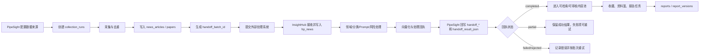

# PipeSight 与 InsightHub 数据交接适配说明

> 版本：V1.0  
> 目标：在不改变 PipeSight 现有表名的前提下，接入同仓库 InsightHub PostgreSQL 采集后处理能力。
> 适用范围：数据采集、外部处理、处理回执、资讯/论文展示和报告生成。

## 1. 结论

PipeSight 负责来源配置、采集调度、原始内容落库和用户侧业务；`backend/src/app/intelligence/processing/` 子系统负责采集结果的深度处理，包括领域识别、分类、Prompt 处理、风险研判和向量化。两者位于同一代码仓库，共用根 Compose 的同一个 PostgreSQL 实例，并通过独立 schema 和明确交接契约保持职责边界。

双方不共享 `hp_*` 表，也不在 PipeSight 新建 `news_embedding`、`sys_prompt_version` 等同义表。PipeSight 保留现有业务表名，通过 `handoff_*` 字段记录外部处理生命周期和结果快照。

PipeSight 的 23 张应用表数量不变。

运行配置通过环境变量注入，不提交密码：

```text
INSIGHTHUB_ENABLED=true
INSIGHTHUB_DB_HOST=ruoyi-pg
INSIGHTHUB_DB_PORT=5432
INSIGHTHUB_DB_NAME=ruoyi-fastapi
INSIGHTHUB_DB_SCHEMA=news
INSIGHTHUB_DB_USER=postgres
INSIGHTHUB_DB_PASSWORD=<Secret，开发环境由 Compose 提供，生产必须覆盖>
INSIGHTHUB_DB_SSLMODE=disable
```

本地一体化 Compose 使用 `postgres` 连接同一实例以简化开发环境；生产环境必须改用最小权限的独立角色、独立密码和网络隔离，不应沿用示例密码。

## 2. 系统边界

| 系统 | 负责内容 | 权威数据 |
|---|---|---|
| PipeSight | 来源配置、采集计划、采集运行、原始资讯/论文、用户筛选、报告 | `data_sources`、`collection_runs`、`news_articles`、`papers`、报告相关表 |
| InsightHub | 新闻处理、领域/分类、Prompt 版本、风险研判、向量检索 | 对方 `news.hp_news`、`hp_domain`、`hp_topic`、`sys_prompt_version`、`news_embedding` |
| Redis/对象存储 | 缓存、锁、运行态指标和文件对象 | 不作为双方关系型事实源 |

## 3. 端到端流程



### 3.1 状态流转

内容表 `news_articles`、`papers`：

```text
pending -> dispatched -> processing -> completed
                         |              |
                         |              +-> rejected
                         +-> failed ----+
```

运行表 `collection_runs`：

```text
pending -> dispatched -> processing -> completed
                                      \-> partial -> failed（重试后可回到 dispatched）
```

状态更新必须幂等；重复回执不得重复覆盖已完成的更高版本结果。

## 4. PipeSight 表字段适配

### 4.1 `data_sources`

保留原表名和原有采集字段，新增：

| 字段 | 用途 |
|---|---|
| `handoff_mode` | `local` 表示本地处理，`external` 表示提交 InsightHub |
| `processor_source_code` | 对方 `hp_data_source` 的稳定来源编码；未配置时使用 `source_code` |

### 4.2 `collection_runs`

保留原采集统计，新增外部处理批次字段：

| 字段 | 用途 |
|---|---|
| `handoff_status` | 外部批次状态：`pending/dispatched/processing/completed/partial/failed` |
| `handoff_batch_id` | 本次提交的幂等批次号 |
| `handoff_count` | 提交给对方的记录数 |
| `handoff_processed_count` | 对方已完成处理的记录数 |
| `handoff_failed_count` | 对方处理失败的记录数 |
| `handoff_time` | 最近一次回执时间 |
| `handoff_error` | 批次级错误摘要 |

### 4.3 `news_articles` / `papers`

保留现有业务字段，新增统一的外部处理字段：

| 字段 | 用途 |
|---|---|
| `handoff_status` | 单条记录外部处理状态 |
| `handoff_batch_id` | 所属外部处理批次 |
| `handoff_record_id` | 对方记录 ID，可对应 `news_id` 或对方业务 UUID |
| `handoff_trace_id` | 对方 Prompt 血缘或处理追踪 ID，对应 `prompt_trace_id` |
| `handoff_version` | 对方处理版本 |
| `handoff_result_json` | 对方返回的领域、分类、风险、标题、摘要、关键词、向量引用等结果快照 |
| `handoff_time` | 回执时间 |
| `handoff_error` | 单条错误摘要 |

`handoff_result_json` 是外部结果的原始快照；PipeSight 的展示字段（标题、摘要、标签、审核状态等）由服务层按版本和审核规则提升，不能反向修改对方事实源。

## 5. 交接消息契约

### 5.1 PipeSight → InsightHub

每条记录至少包含：

```json
{
  "handoff_batch_id": "run-20260824-0001",
  "article_id": "article-001",
  "content_type": "news",
  "source_code": "source-example",
  "canonical_url": "https://example.com/item",
  "title": "原始标题",
  "summary": "原始摘要",
  "body": "原始正文",
  "published_time": "2026-08-24T08:00:00+08:00",
  "article_hash": "sha256...",
  "metadata": {}
}
```

当前 166 数据库没有论文目标表。论文继续只写入 PipeSight 的 `papers`；只有对方补充论文表或接口契约后，才增加论文交接，不得把论文写入 `hp_news`。

### 5.2 InsightHub → PipeSight

回执至少包含：

```json
{
  "handoff_batch_id": "run-20260824-0001",
  "handoff_record_id": "external-record-001",
  "handoff_trace_id": "01J...",
  "status": "completed",
  "version": "processor-v1",
  "result": {
    "ai_title": "处理后标题",
    "summary": "处理后摘要",
    "domain_id": 10,
    "domain": "管道完整性",
    "category_id": 20,
    "score": 0.87,
    "warning_grade": "一般",
    "warning_cause": "示例原因",
    "focus_risk": "示例风险",
    "suggestion": "示例建议",
    "event_keywords": ["管道", "监测"],
    "embedding_ref": "external-vector-id"
  },
  "error": null
}
```

完整回执写入 `handoff_result_json`；`handoff_record_id` 和 `handoff_trace_id` 单独落列用于幂等、检索和审计。

## 6. 幂等、重试与删除

1. 批次幂等键为 `handoff_batch_id + article_id/paper_id`。
2. 对方回执按 `handoff_record_id + handoff_version` 去重；低版本回执不得覆盖高版本结果。
3. PipeSight 只重试 `failed`、`partial` 或超时的记录，不重复提交 `completed` 记录。
4. 采集源删除使用原有 `RESTRICT` 语义；内容记录保留来源快照，避免对方处理历史失去来源说明。

## 7. 当前实现入口

PipeSight 已提供两个受保护接口，供采集执行器或运维任务调用：

```text
POST /pipeline/tasks/runs/{run_id}/handoff
POST /pipeline/tasks/runs/{run_id}/handoff/sync
```

第一步提交指定采集运行中的资讯，第二步轮询 `news.hp_news` 并回写本地 `handoff_*` 字段。论文不会提交到 InsightHub，因为当前目标库没有论文表。

应用启动后，持有 Scheduler Leader 锁的 Worker 会注册 `_pipesight_insighthub_handoff_poll`，默认每 30 秒扫描 `dispatched`、`processing`、`partial` 状态的 `collection_runs`。轮询间隔通过 `INSIGHTHUB_POLL_INTERVAL_SECONDS` 配置，允许范围为 5～3600 秒；同一时刻最多执行一个轮询实例。

真实采集执行器完成落库后调用 `finalize_collection_run(db, run_id)`：先把采集运行标记为成功，再复用现有提交服务将该运行下待处理资讯送入 InsightHub。没有真实采集结果时不会自动提交空运行。

现场核验发现 `hp_news.news_id` 与 `hp_data_source.web_source_id` 没有序列默认值。当前适配器在事务内使用 PostgreSQL advisory lock + `MAX(id)+1` 分配 ID；这是迁移期兼容方案，若 InsightHub 后续提供共享 sequence，应切换为 sequence，避免多写入方各自分配 ID。

生产配置必须使用最小权限的独立角色和 Secret；当前 Compose 中的 `postgres/root` 仅用于本地开发，生产不得沿用。
5. 对方删除或归档不自动删除 PipeSight 内容；由双方通过明确的归档回执同步 `review_status` 或扩展状态。

## 8. 报告使用边界

只有 `handoff_status = 'completed'` 且通过 PipeSight 审核的资讯/论文，才能进入用户收藏、资料篮和 `generation_tasks.selected_items`。

报告生成只读取 PipeSight 的快照，不在生成过程中直接查询对方数据库。报告和版本的引用以本系统 `reports.citations`、`report_versions.citations` 为准。

## 9. 联调验收

- 采集成功后，`collection_runs.handoff_status` 能进入 `dispatched`；
- 对方能按 `handoff_batch_id` 接收资讯和论文；
- 成功回执能幂等写入 `handoff_*` 字段；
- 失败回执保留错误信息并可重试；
- 完成记录能进入检索、收藏和报告生成；
- 重复回执、乱序回执和低版本回执不会破坏已完成结果；
- PipeSight 不创建与对方 `hp_*`、Prompt 或向量表含义重复的表。
