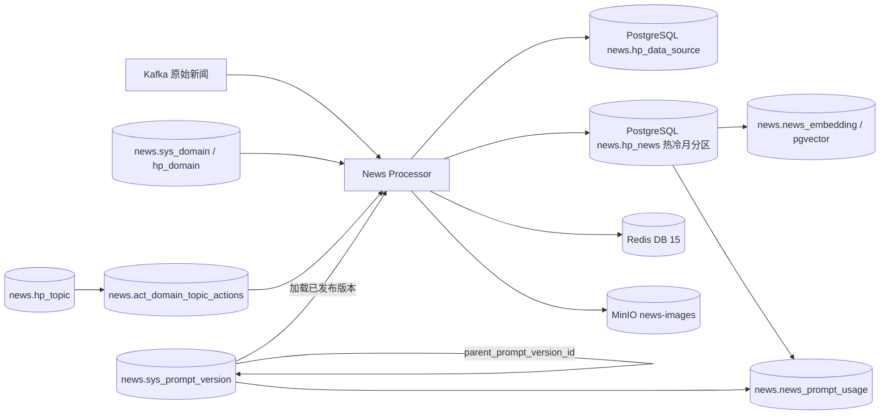
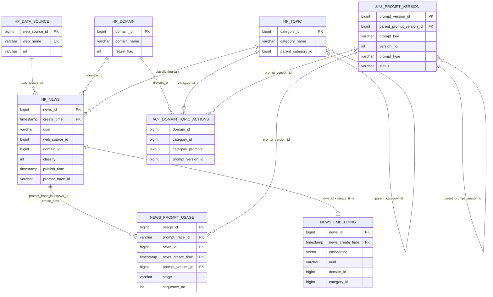

# InsightHub 数据库设计

> 文档状态：已核验并迁移 `172.16.4.166:5432/pipeline_news` 的 `news` schema。  
> 核验与迁移日期：2026-08-18。  
> 安全约束：本文仅记录非敏感连接信息；不记录密码、Token、API Key 或 JWT Secret。

> **当前基线（2026-10-03）**：本文保留 2026-08-18 的远端数据库迁移快照；当前仓库运行链已经切换为根目录 `docker-compose.pg.yml`，由 `ruoyi-pg` 提供 PostgreSQL 16 + pgvector，PipeSight 使用 `public` schema，InsightHub Worker 使用 `news` schema。当前运行代码不再连接本文所列的 MySQL/Milvus 迁移来源；相关内容仅用于历史回填、对账和交接追溯。

### 设计资产

| 文件 | 作用 | 执行状态 |
|---|---|---|
| `04_pipeline_news_pg_migration.sql` | `pipeline_news.news` 的增量迁移：Prompt 血缘、领域分类关系、pgvector、权限；保持新闻热冷分区 | **已于 2026-08-18 执行成功** |
| `02_pgvector_operations.sql` | 真实复合新闻键下的向量重建判断、UPSERT、查询和漂移检查 | 当前 Adapter/运维操作契约 |
| `01_pgvector_schema.sql` | 早期单表 pgvector 草案 | 已废弃，禁止执行 |
| `03_prompt_lineage_schema.sql` | 早期 MySQL Prompt 血缘草案 | 已废弃，禁止执行 |
| `05_pg_column_comments.sql` | `news` Schema 新增对象的逐列数据库级备注 | **已于 2026-08-18 执行成功** |
| `06_pg_all_column_comments.sql` | `news` Schema 全部表、视图、新闻分区和 pg_partman 管理对象的表级/字段级备注 | **已于 2026-08-18 执行成功**；审计缺口为 0 |

本文解释设计意图；`04_pipeline_news_pg_migration.sql` 是已部署 PostgreSQL 结构的迁移事实源。

### 对象完整性结论

2026-08-18 已将源码 SQL 引用、本文设计对象与 `pipeline_news.news` 实际对象做差集核验，必需表/视图缺失数为 **0**。当前基线为：`hp_news`、`hp_data_source`、`hp_domain`、`sys_domain`、`hp_topic`、`act_domain_topic_actions`、`sys_prompt_version`、`news_prompt_usage`、`news_embedding`。

全量备注审计：`news` Schema 共 31 个表/视图对象，所有对象均有表级备注，所有列均有字段备注；`hp_news` 19 个分区均已覆盖。
MySQL 源库中的 `act_user_*`、报告、素材、法律、标准、专利、追踪等对象不被本项目运行时代码访问，不属于当前迁移范围。数据库迁移采用业务边界切片，不做源库全量复制。

## 1. 范围与存储拓扑

InsightHub 的目标关系数据库已经落在 PostgreSQL `pipeline_news.news`。新闻事实、领域、分类、Prompt 血缘和向量均在同一 schema；Redis 与 MinIO 保持原职责。当前仓库中的 Worker 已使用 PostgreSQL、pgvector、Redis 和可选 MinIO Adapter；MySQL/Milvus 仅作为历史迁移来源保留。

| 存储 | 状态 | 当前对象 | 职责 |
|---|---|---|---|
| PostgreSQL 新闻库 | 已部署 | `pipeline_news.news.hp_news` | 新闻事实；按 `create_time` 月分区，保持热冷表空间 |
| PostgreSQL 配置库 | 已部署 | `hp_domain`、`sys_domain` View、`hp_topic`、`act_domain_topic_actions` | 领域、分类和分类标准 Prompt 绑定 |
| PostgreSQL Prompt 血缘 | 已部署 | `sys_prompt_version`、`news_prompt_usage` | Prompt 版本、父版本派生和新闻使用溯源 |
| PostgreSQL + pgvector | 已部署 | `news.news_embedding` | 向量、过滤投影和轻量检索快照 |
| MySQL / Milvus | 历史迁移来源 | 旧 Worker 的历史连接 | 不属于当前运行链；仅用于回填和对账 |
| Redis | 保留 | DB `15` | 去重、协调、指标、告警和认证状态 |
| MinIO | 保留 | Bucket `news-images` | 新闻图片/封面对象 |



## 2. 配置与边界

### 2.1 连接配置

| 存储 | 配置变量 | 当前非敏感值 | 说明 |
|---|---|---|---|
| PostgreSQL | 待新增项目配置 | `172.16.4.166:5432/pipeline_news`，Schema `news` | 应用角色 `news_app` 已获新表 DML 和序列权限。 |
| Redis | `REDIS_HOST` / `REDIS_PORT` / `REDIS_DB` | `127.0.0.1:6379` / `15` | Worker 与告警系统共用。 |
| 迁移来源 MySQL | 历史 `MYSQL_*` / `DOMAIN_CONFIG_MYSQL_*` | `172.16.4.183:3306` | 不由当前运行链读取；仅用于历史回填和对账。 |
| 迁移来源 Milvus | 历史 `MILVUS_*` | `http://172.16.4.182:30003` / `news` | 不由当前运行链读取；pgvector 为当前向量目标。 |
| MinIO | `MINIO_ENDPOINT` / `MINIO_BUCKET_NAME` | `172.16.4.181:9000` / `news-images` | 对象存储保持不变。 |

密码必须通过 Secret/环境变量注入，不得进入源码或本文档。

### 2.2 一致性模型

1. `news.hp_news` 是新闻事实源，真实主键为 `(news_id, create_time)`。
2. `hp_news` 保持 `RANGE(create_time)` 月分区；当前 19 个分区中 12 个位于 `ts_hot`、7 个位于 `ts_cold`。
3. `news_embedding` 与 `news_prompt_usage` 均携带 `news_create_time`，通过复合外键关联分区新闻。
4. 删除新闻行时，向量和 Prompt 使用明细由同库外键级联删除。
5. Prompt 版本和新闻血缘已经在 PostgreSQL 建模；应用切换时不得继续向 MySQL 创建第二套 Prompt 事实源。
6. Redis 状态均为运行期数据或缓存，不作为新闻事实数据源。

## 3. 实体关系

### 3.1 逻辑 ER 图



> `news.sys_domain` 是当前领域配置兼容 View，直接读取 `news.hp_domain`，不复制领域数据。

### 3.2 关系约束与风险

| 关系 | 业务约束 | 当前物理约束 | 维护方 |
|---|---|---|---|
| `hp_news.web_source_id → hp_data_source.web_source_id` | 每个由 Worker 写入的新闻应有来源。 | 当前未定义外键；由应用写入顺序维护。 | PostgreSQL 新闻 Adapter。 |
| `hp_news.domain_id → hp_domain.domain_id` | 一条领域处理结果归属一个领域。 | 当前未定义外键；`domain_id` 有分区索引。 | 领域处理器。 |
| `hp_news.classify → hp_topic.category_id` | 分类 ID 属于当前领域可用分类。 | 当前未定义外键；类型分别为 integer / bigint。 | 分类处理器。 |
| `act_domain_topic_actions.domain_id → hp_domain.domain_id` | 领域绑定分类。 | PostgreSQL 物理外键，删除领域时级联。 | Prompt Registry。 |
| `act_domain_topic_actions.category_id → hp_topic.category_id` | 分类绑定分类标准 Prompt。 | PostgreSQL 物理外键，删除分类时级联。 | Prompt Registry。 |
| `hp_topic.parent_category_id → hp_topic.category_id` | 分类树父子关系。 | 目前只有索引，无自关联外键。 | 分类管理端。 |
| `news_embedding.(news_id, news_create_time) → hp_news.(news_id, create_time)` | 一个向量行对应一个分区新闻行。 | 同库复合外键，删除新闻时级联。 | pgvector Adapter。 |
| `sys_prompt_version.parent_prompt_version_id → sys_prompt_version.prompt_version_id` | 一个版本可从一个历史版本派生；父版本可跨 `prompt_key`。 | 自关联外键，禁止删除父版本；长环路由发布流程校验。 | Prompt 发布模块。 |
| `news_prompt_usage.(prompt_trace_id, news_id, news_create_time) → hp_news.(prompt_trace_id, news_id, create_time)` | 成功入库新闻记录全部 Prompt 版本。 | 同库复合外键，删除新闻时级联。 | Worker 入库后批量写入。 |
| `news_prompt_usage.prompt_version_id → sys_prompt_version.prompt_version_id` | 使用记录指向不可变 Prompt 版本。 | PostgreSQL 外键限制删除。 | Prompt 血缘收集模块。 |


## 4. PostgreSQL 主业务 Schema：`pipeline_news.news`

> 本章字段来自原 MySQL 模型，但当前权威物理结构是 PostgreSQL。`news.hp_news` 的热冷月分区保持不变。

### 4.1 `hp_news` — 分区新闻事实表

**用途**：处理后新闻的事实主表。按 `create_time` 执行 PostgreSQL 原生 RANGE 月分区；当前 19 个分区中 12 个位于 `ts_hot`、7 个位于 `ts_cold`，另有位于 `ts_hot` 的默认分区。

**主键与关键标识**

| 字段 | 类型 | 可空 | 键/默认值 | 说明 |
|---|---|---:|---|---|
| `news_id` | `bigint` | 否 | 复合 PK | 新闻 ID；与分区键共同组成主键。 |
| `create_time` | `timestamp without time zone` | 否 | 复合 PK、分区键、默认 `CURRENT_TIMESTAMP` | 月分区键，不得改变。 |
| `uuid` | `varchar(255)` | 是 | 分区索引 | 上游业务标识，不唯一。 |
| `prompt_trace_id` | `varchar(26)` | 是 | 分区索引 | Prompt 血缘 ULID 入口。 |
| `web_source_id` | `bigint` | 是 | 分区索引 | 逻辑关联 `hp_data_source`。 |
| `domain_id` | `bigint` | 是 | 分区索引 | 逻辑关联 `hp_domain`。 |
| `classify` | `integer` | 是 | 分区索引 | 逻辑关联 `hp_topic.category_id`。 |

**内容与来源字段**

| 字段 | 类型 | 可空 | 默认值 | 说明 |
|---|---|---:|---|---|
| `original_title` | `varchar(512)` | 是 | — | 原始标题；有索引。 |
| `original_text` | `text` | 是 | — | 正文，优先写 Markdown 正文。 |
| `translated_title` | `varchar(512)` | 是 | — | 翻译标题。 |
| `translated_text` | `text` | 是 | — | 翻译正文。 |
| `summary` | `text` | 是 | — | 摘要。 |
| `ai_title` | `text` | 是 | — | AI 改写标题。 |
| `source` | `varchar(255)` | 是 | — | 来源站点名称。 |
| `cover_image_url` | `varchar(4096)` | 是 | — | MinIO 或外部封面 URL。 |
| `external_link` | `varchar(4096)` | 是 | — | 原始外部链接。 |
| `url` | `varchar(255)` | 是 | — | 预留新闻链接字段；Worker 当前写 `external_link`。 |
| `author_id` | `bigint` | 是 | — | 作者 ID；本 Worker 不写入。 |
| `platform` | `integer` | 是 | — | 平台标识，注释约定 `1=微信`。 |

**处理、风险与领域字段**

| 字段 | 类型 | 可空 | 默认值 | 说明 |
|---|---|---:|---|---|
| `score` | `real` | 是 | — | 预警/风险评分；有索引。 |
| `warning_grade` | `varchar(255)` | 是 | — | 预警等级。 |
| `warning_cause` | `varchar(500)` | 是 | — | 预警原因。 |
| `domain` | `varchar(255)` | 是 | — | 领域名称。 |
| `content_extraction` | `text` | 是 | — | 内容提取结果的 JSON 序列化。 |
| `event_keywords` | `text` | 是 | — | 搜索/事件关键词。 |
| `other` | `text` | 是 | — | Worker 写入 `NewsFeatures` JSON。 |
| `other_cn` | `text` | 是 | — | 既有扩展字段。 |
| `filter_result` | `text` | 是 | — | 过滤结果。 |
| `background` | `text` | 是 | — | 背景信息。 |
| `focus_risk` | `varchar(500)` | 是 | — | 关注风险。 |
| `suggestion` | `text` | 是 | — | 对策建议。 |
| `judgment_opinion` | `text` | 是 | — | 研判意见。 |

**生命周期、运营与遗留字段**

| 字段 | 类型 | 可空 | 默认值 | 说明 |
|---|---|---:|---|---|
| `create_time` | `timestamp without time zone` | 否 | `CURRENT_TIMESTAMP` | 新闻创建时间和不可变分区键。 |
| `publish_time` | `timestamp without time zone` | 否 | — | 新闻发布时间；沿用 `Asia/Shanghai` 业务时间。 |
| `timestamp` | `timestamp without time zone` | 是 | — | 既有时间戳字段。 |
| `del_flag` | `char(1)` | 是 | `0` | 软删除：`0` 存在、`2` 删除。 |
| `is_featured` | `smallint` | 是 | `0` | 是否推荐。 |
| `is_top` | `char(1)` | 是 | — | 是否置顶。 |
| `type` | `char(10)` | 是 | — | 内容类型。 |
| `favorites` / `likes` / `shares` / `bad` | `integer` | 是 | `0` | 交互计数。 |
| `tags` | `text` | 是 | — | 既有扩展标签。 |
| `news_all_info` | `text` | 是 | — | 原始全量信息。 |

**索引**

| 索引 | 字段 | 支持的访问模式 |
|---|---|---|
| `PRIMARY` | `news_id, create_time` | 分区表复合主键定位。 |
| `hp_news_idx_uuid_idx` | `uuid` | 业务新闻标识检索，继承到各分区。 |
| `hp_news_idx_title_idx` | `original_title` | 标题查询，继承到各分区。 |
| `hp_news_normal_web_source_id_idx` | `web_source_id` | 按来源查询。 |
| `hp_news_idx_domain_id_idx` | `domain_id` | 按领域查询。 |
| `hp_news_idx_classify_idx` | `classify` | 按分类查询。 |
| `hp_news_idx_publish_time_idx` | `publish_time` | 时间范围查询。 |
| `hp_news_idx_score_idx` | `score` | 风险评分筛选。 |
| `hp_news_idx_source_domain_idx` | `web_source_id, domain_id` | 来源+领域查询。 |
| `hp_news_idx_hp_news_domain_del_pub_news_idx` | `domain_id, del_flag, publish_time DESC, news_id DESC` | 领域新闻流分页。 |
| `hp_news_idx_hp_news_domain_classify_del_pub_news_idx` | `domain_id, classify, del_flag, publish_time DESC, news_id DESC` | 领域+分类新闻流分页。 |
| `hp_news_prompt_trace_idx` | `prompt_trace_id, create_time` | Prompt 血缘入口查询。 |

**热冷分区不变量**：不得重建父表、改分区键或把历史分区合并回主表。新月分区继续进入 `ts_hot`；超过热数据窗口的整月分区继续迁移到 `ts_cold`；默认分区保持在 `ts_hot`。

### 4.2 `hp_data_source` — 数据源表

**用途**：媒体/站点来源主数据。Worker 以 `web_name` 不区分大小写查询；不存在时用新闻 URL 的 `scheme://netloc` 创建来源。

| 字段 | 类型 | 可空 | 键/默认值 | 说明 |
|---|---|---:|---|---|
| `web_source_id` | `bigint` | 否 | PK，自增 | 来源主键。 |
| `web_name` | `varchar(255)` | 否 | 唯一索引 | 来源名称；应用侧按 `LOWER(web_name)` 查询。 |
| `url` | `varchar(512)` | 否 | — | 来源根 URL。 |
| `web_name_cn` | `varchar(255)` | 是 | — | 中文名称。 |
| `description` | `text` | 是 | — | 来源说明。 |
| `category` | `char(1)` | 是 | — | 既有分类。 |
| `data_source_classify` | `char(1)` | 是 | 组合索引首列 | `1=数据源`，`2=机构`。 |
| `content_type` | `enum('HTML','RSS','JSON','Other')` | 是 | — | 获取内容类型。 |
| `authentication_required` | `char(1)` | 是 | `0` | 是否需要认证。 |
| `last_crawled_timestamp` | `timestamp` | 是 | — | 最后抓取时间。 |
| `next_crawl_priority` | `char(1)` | 是 | `0` | `2` 高、`1` 中、`0` 低。 |
| `is_crawled` | `char(1)` | 是 | `0` | 是否完成抓取。 |
| `logo_path` / `logo_url` | `varchar(512)` | 是 | — | Logo 路径/URL。 |
| `other` | `json` | 是 | — | 扩展属性。 |
| `tag` | `varchar(1000)` | 是 | — | 标签。 |
| `create_by` / `create_time` / `remark` | `varchar(255)` / `datetime` / `text` | 是 | — | 审计与备注。 |

索引：`PRIMARY(web_source_id)`、`web_name_idx(web_name)`（唯一）、`idx_classify_create_source(data_source_classify, create_time DESC, web_source_id)`。

### 4.3 `hp_domain` 与 `sys_domain` — 领域配置

**用途**：领域主数据、过滤提示词和评分提示词。`sys_domain` 是动态配置加载的实际访问名；`hp_domain` 同时被新闻写入辅助查询读取。

| 字段 | 类型 | 可空 | 键/默认值 | 说明 |
|---|---|---:|---|---|
| `domain_id` | `bigint` | 否 | PK，自增 | 领域主键。 |
| `domain_name` | `varchar(255)` | 是 | — | 领域名称。 |
| `filter_prompts` | `text` | 是 | — | 过滤提示词，动态处理器解析为 JSON/文本。 |
| `score_prompts` | `text` | 是 | — | 评分提示词，动态处理器解析为 JSON/文本。 |
| `return_flag` | `int` | 是 | `0` | 处理器类型；代码约定 `0` 为本地处理器。 |
| `del_flag` | `char(1)` | 是 | `0` | `0` 有效、`2` 已删除；动态加载仅取 `0`。 |
| `remark` | `varchar(2000)` | 是 | — | 说明。 |
| `user_id` | `bigint` | 是 | — | 创建用户。 |
| `create_by` / `create_time` | `varchar(255)` / `datetime` | 是 | — | 创建审计。 |
| `update_by` / `update_time` | `varchar(255)` / `datetime` | 是 | — | 更新审计；`update_time` 支持自动更新。 |
| `other` | `varchar(255)` | 是 | — | 扩展字段。 |

索引：`PRIMARY(domain_id)`。

### 4.4 `hp_topic` — 分类树

**用途**：分类字典与树结构。动态领域查询仅取 `del_flag='0'` 且 `is_active='0'` 的分类，再由领域—分类关联表筛选属于当前领域的项目。

| 字段 | 类型 | 可空 | 键/默认值 | 说明 |
|---|---|---:|---|---|
| `category_id` | `bigint` | 否 | PK，自增 | 分类主键。 |
| `category_name` | `varchar(255)` | 否 | — | 分类名称。 |
| `category_description` | `text` | 是 | — | 分类说明。 |
| `parent_category_id` | `bigint` | 是 | 普通索引 | 父分类 ID。 |
| `ancestors` | `varchar(255)` | 是 | — | 祖先路径。 |
| `domain_id` | `int` | 是 | — | 既有领域字段。动态关联仍以 `act_domain_topic_actions` 为准。 |
| `return_flag` | `int` | 是 | `0` | 既有处理标志。 |
| `is_active` | `char(1)` | 是 | `0` | `0` 启用、`1` 禁用。 |
| `del_flag` | `char(1)` | 是 | `0` | `0` 有效、`2` 删除。 |
| `sort_order` | `int` | 是 | — | 展示/提示词排序。 |
| `other` | `json` | 是 | — | 扩展属性。 |
| `remark` | `text` | 是 | — | 备注。 |
| `create_by` / `create_time` | `varchar(255)` / `datetime` | 是 | `CURRENT_TIMESTAMP`（时间） | 创建审计。 |
| `update_by` / `update_time` | `varchar(255)` / `datetime` | 是 | — | 更新审计。 |

索引：`PRIMARY(category_id)`、`idx_parent_category_id(parent_category_id)`。

### 4.5 `act_domain_topic_actions` — 领域分类提示词关联

**用途**：连接领域与分类，并为一个领域下的分类提供专属分类提示词。当前代码通过 `LEFT JOIN` 获取 `category_prompts`，仅保留非空提示词记录。

| 字段 | 类型 | 可空 | 索引 | 说明 |
|---|---|---:|---|---|
| `domain_id` | `bigint` | 否 | 无 | 逻辑关联领域。 |
| `category_id` | `bigint` | 否 | 无 | 逻辑关联分类。 |
| `category_prompts` | `text` | 否 | 无 | 该领域对此分类的判定标准。 |

当前 schema **没有主键、唯一约束、索引或物理外键**。该表已确认仍被运行代码使用，不能删除。
**设计注意：** `act_domain_topic_actions` 当前保留并由动态分类链路读取。其没有复合唯一键，后续配置丰富前应避免重复 `(domain_id, category_id)` 行，否则会产生重复分类候选项。

### 4.6 `sys_prompt_version` — 提示词版本与派生关系

**用途**：统一存储过滤、分类、评分、预警、标题摘要抽取和实体抽取 Prompt。每行是一个不可变版本；修改内容必须新增版本，不能覆盖已经发布或使用过的历史行。完整 DDL 位于 `03_prompt_lineage_schema.sql`。

| 字段 | 类型 | 说明 |
|---|---|---|
| `prompt_version_id` | `bigint` | Prompt 版本主键。 |
| `parent_prompt_version_id` | `bigint` | 可空自关联父版本。根版本为空；一个父版本可以派生多个子版本。 |
| `prompt_key` | `varchar(150)` | Prompt 稳定业务键，例如 `politics.filter`。 |
| `prompt_name` | `varchar(255)` | 展示名称。 |
| `prompt_type` | `varchar(50)` | `FILTER`、`CLASSIFY`、`CLASSIFY_CRITERION`、`SCORE`、`WARNING`、`TITLE_SUMMARY_EXTRACT`、`ENTITY_EXTRACT` 等。 |
| `domain_id` / `category_id` | `bigint` | 可空适用范围。全局 Prompt 两者均为空。 |
| `version_no` | `int` | 同一 `prompt_key` 内递增的版本号。 |
| `system_prompt` / `user_prompt` | `mediumtext` | Prompt 模板正文。 |
| `template_variables` | `json` | 模板所需变量清单。 |
| `content_hash` | `char(64)` | 规范化 Prompt 内容 SHA-256。 |
| `status` | `enum` | `draft`、`published`、`retired`。同一 `prompt_key` 最多一个 published 版本。 |
| `derivation_note` | `varchar(1000)` | 说明从父版本派生的原因与主要改动。 |
| `created_by` | `varchar(255)` | 创建人。 |
| `created_at` | `datetime(6)` | 版本创建时间。 |
| `updated_at` | `datetime(6)` | 最后修改时间；草稿编辑或允许的状态变更时自动更新。 |
| `published_at` | `datetime(6)` | 正式发布时间；published 状态必须非空。 |

#### 父版本语义

`parent_prompt_version_id` 指向**直接派生来源版本**，不是简单等同于“上一版本”。它支持：

```text
同一 Prompt 演进：politics.filter v2 → politics.filter v3
跨 Prompt 派生： common.filter v4   → biology.filter v1
```

第一阶段采用单父树模型：每个版本最多一个直接父版本，但一个父版本可以拥有多个子版本。PostgreSQL 自关联外键阻止不存在父节点和删除被引用父节点；CHECK 阻止自指，长度大于 1 的环必须在发布事务中从父节点向上遍历校验。未来只有出现真实的多父合并需求时，才增加多父关系表。

### 4.7 `news_prompt_usage` — 新闻 Prompt 使用血缘

**用途**：记录成功写入 `hp_news` 的新闻使用过哪些 Prompt 版本、处理阶段、顺序和模型。Worker 在内存中累计，新闻入库取得 `prompt_trace_id` 后批量写入。

| 字段 | 类型 | 说明 |
|---|---|---|
| `usage_id` | `bigint` | 使用记录主键。 |
| `prompt_trace_id` | `varchar(26)` | Prompt 血缘 ULID。 |
| `news_id` | `bigint` | 分区新闻 ID。 |
| `news_create_time` | `timestamp without time zone` | 新闻分区键；与 `news_id`、`prompt_trace_id` 共同建立外键。 |
| `stage` | `varchar(50)` | 使用阶段；同一阶段可以出现多个分类标准 Prompt。 |
| `prompt_version_id` | `bigint` | 实际使用的不可变 Prompt 版本。 |
| `sequence_no` | `integer` | 本次新闻处理中的使用顺序。 |
| `model_name` | `varchar(255)` | 实际调用模型。 |
| `created_at` | `timestamptz` | 使用记录生成时间。 |

`hp_news.prompt_trace_id` 是血缘查询入口；由于主表按 `create_time` 分区，物理外键使用 `(prompt_trace_id, news_id, news_create_time)`。精简方案只追踪成功入库新闻；被过滤或失败且未入库的新闻暂不保存血缘。

### 4.8 分类提示词迁移

`act_domain_topic_actions` 增加 `prompt_version_id`，逐步替代内嵌 `category_prompts`。迁移期间允许双列并存用于数据校验，但读取切换完成后必须删除 `category_prompts`，避免 Prompt 文本出现两个事实源。

分类调用可能同时使用一个 `CLASSIFY` 主模板和多个 `CLASSIFY_CRITERION` 标准版本，所有版本分别写入 `news_prompt_usage`，才能完整还原当时的分类依据。

## 5. 向量存储：Milvus 迁移来源与已部署 pgvector

### 5.1 设计结论

PostgreSQL `news.hp_news` 是新闻事实单一来源；`news.news_embedding` 保存向量检索字段、过滤投影和体积可控的检索快照：

1. 通过 `(news_id, news_create_time)` 关联分区新闻；
2. 相似度计算所需的 `embedding`；
3. 模型、输入版本和 `source_hash`；
4. 领域、分类和发布时间过滤投影；
5. `uuid`、关键词、标题、来源、领域名称、链接、封面和生产者等轻量快照。

查询可以直接使用 pgvector 返回轻量结果；需要正文、摘要、内容提取或最新状态时，在同一 PostgreSQL 数据库内通过复合键 JOIN `news.hp_news`。快照与主表冲突时以 `hp_news` 为准。

### 5.2 当前 Milvus 冗余

当前 `news` Collection 的应用写入契约包含 `news_id`、`uuid`、`domain_id`、`summary_vector`，同时复制 `key_words`、`original_text`、`summary`、`title`、`ai_title`、`source`、`domain`、`classify`、`publish_time`、`external_link`、`cover_image_url`、`content_extraction` 和 `producer`。

迁移时不复制以下大字段：

| 删除字段 | 原因 |
|---|---|
| `original_text` | 正文体积大、更新成本高；命中后通过复合键查询 `news.hp_news`。 |
| `summary` | 属于新闻事实和详情内容；避免形成双写事实源。 |
| `content_extraction` | 结构较大且可能持续演进，不参与向量距离和主要过滤。 |

保留 `uuid`、`key_words`、`title`、`ai_title`、`source`、`domain`、`external_link`、`cover_image_url` 和 `producer`。这些字段属于**可重建检索快照**，用于直接展示轻量命中结果、按业务标识排障、来源判断和生产者溯源，不承担最终事实语义。

`domain_id`、分类 ID 和发布时间保留为**检索过滤投影**，确保过滤发生在近邻排序之前，避免先全库 Top-K 再过滤造成召回失真。

### 5.3 已部署表：`news.news_embedding`

Embedding Endpoint 已实测 `Pro/BAAI/bge-m3` 输出 **1024 维**，已部署字段为 `news.vector(1024)`。完整已执行 DDL 位于 `04_pipeline_news_pg_migration.sql`；`01_pgvector_schema.sql` 是已废弃草案，不得执行。

已部署结构包含：

- `vector` Extension；
- `news_embedding` 表和非空/格式检查约束；
- `updated_at` 自动更新时间触发器；
- `uuid` 普通索引；
- cosine 距离 HNSW 索引；
- 领域、分类与发布时间过滤索引。

已部署表核心结构如下：

```text
news_id PK
news_create_time PK
uuid
embedding news.vector(1024)
embedding_model / embedding_version / source_hash
domain_id / category_id / published_at
key_words / title / ai_title
source / domain / external_link / cover_image_url / producer
created_at / updated_at
```

### 5.4 字段职责

| 字段 | 类型 | 必需 | 职责 |
|---|---|---:|---|
| `news_id` | `bigint` | 是 | 复合主键第一列，对应 `hp_news.news_id`。 |
| `news_create_time` | `timestamp without time zone` | 是 | 复合主键第二列，对应 `hp_news.create_time` 分区键。 |
| `uuid` | `varchar(255)` | 是 | 业务新闻标识快照；普通索引，不唯一。 |
| `embedding` | `vector(1024)` | 是 | 当前 BGE-M3 语义向量；使用 cosine 距离。 |
| `embedding_model` | `text` | 是 | 完整模型标识，例如 `Pro/BAAI/bge-m3`。 |
| `embedding_version` | `integer` | 是 | 输入拼接/清洗算法版本；算法变化时触发重建。 |
| `source_hash` | `char(64)` | 是 | 实际 embedding 输入文本的 SHA-256；用于幂等 upsert 和陈旧检测。 |
| `domain_id` | `bigint` | 否 | 检索过滤投影，对应 `hp_news.domain_id`。 |
| `category_id` | `bigint` | 否 | 检索过滤投影，对应 `hp_news.classify`。名称统一为 `category_id`。 |
| `published_at` | `timestamp without time zone` | 否 | 时间范围过滤投影；沿用当前 `Asia/Shanghai` 业务时间语义。 |
| `key_words` | `text` | 是 | 关键词快照，可用于结果解释或后续混合检索。 |
| `title` / `ai_title` | `varchar(512)` / `text` | 是 | 轻量结果标题快照。 |
| `source` / `domain` | `varchar(255)` | 否 | 来源和领域名称快照，轻量结果可直接展示。 |
| `external_link` / `cover_image_url` | `varchar(4096)` | 否 | 轻量结果跳转与封面快照。 |
| `producer` | `varchar(100)` | 是 | 数据生产者溯源，默认 `insight_hub`。 |
| `created_at` / `updated_at` | `timestamptz` | 是 | 向量行创建与更新审计时间，使用数据库时钟。 |

### 5.5 写入与更新规则

- 使用 `(news_id, news_create_time)` 做幂等 UPSERT；同一分区新闻行仅保留一个当前有效向量。
- `embedding_version=1` 的精确输入字符串为：`标题: {ai_title 非空时取 ai_title，否则取 title} 摘要: {abstract}`。
- `source_hash` 是上述 UTF-8 输入字符串的 SHA-256 小写十六进制。
- `source_hash`、`embedding_model`、`embedding_version` 未变化时可跳过向量生成；快照变化仍执行轻量 UPSERT。
- 主表领域、分类、发布时间或轻量展示字段变化时同步过滤投影和快照。
- `ai_title`、`abstract` 或输入规范变化导致 `source_hash` 变化时重新生成向量。
- 删除 `news.hp_news` 时，同库复合外键自动级联删除向量；无需孤儿清理补偿。
- 定期对账只需检查 `source_hash` 和检索快照漂移。

### 5.6 查询契约

查询必须按实际过滤条件动态拼接 `WHERE`，不要使用 `($param IS NULL OR column = $param)` 作为统一模板；后者可能妨碍 PostgreSQL 为不同过滤组合选择合适计划。

```sql
-- 示例：限定领域和起始发布时间
SELECT
    news_id,
    news_create_time,
    embedding <=> $1::news.vector AS distance
FROM news.news_embedding
WHERE domain_id = $2
  AND published_at >= $3
ORDER BY embedding <=> $1::news.vector
LIMIT $4;
```

需要正文或最新事实字段时，使用 `(news_id, news_create_time)` JOIN `news.hp_news`；不需要跨数据库回查。

HNSW 属于近似索引，普通字段过滤与向量候选生成的组合可能减少有效结果。上线前必须用真实数据分布验证过滤后的 Top-K 召回率；根据 PostgreSQL/pgvector 版本和压测结果选择提高搜索候选、启用 iterative scan、查询过采样，或对稳定且高选择性的领域维度进行分区。不能仅因存在 B-tree 过滤索引就假定 Top-K 完整。

### 5.7 应用迁移步骤

1. PostgreSQL、Vector Extension、`news_embedding` 和 HNSW 索引已经部署完成。
2. 实现 PostgreSQL 新闻 Adapter、Prompt Registry/Lineage 和 pgvector Adapter。
3. 从迁移来源 MySQL 分批导入 `news.hp_news`，保持目标表 `create_time` 月分区边界。
4. 从目标 PostgreSQL 新闻行生成/回填向量，不从 Milvus 冗余文本构造事实数据。
5. 双写观察期比较新闻写入、Prompt 血缘、向量成功率和固定查询集 Top-K。
6. 应用读取切换到 PostgreSQL 后，停止 MySQL/Milvus 写入并完成对账下线。

迁移期间不得让 Milvus 与 pgvector 定义两套向量输入规则；Embedding 输入构建必须集中在同一个深 Module 内。

## 6. Redis：DB 15 键设计

### 6.1 Worker 去重与缓存

| 键模式 | Redis 类型 | 值 | TTL | 用途 |
|---|---|---|---:|---|
| `news_hash:{simhash}` | String | `"1"` | 30 天 | `SET NX` 去重；不存在才写入。 |
| `title:{title}` | String | JSON 字符串数组，例如 `["领域A"]` | 30 天 | 标题到已命中领域的缓存。 |
| `{filter_name}` | RedisBloom Filter | Bloom 成员 | 由 RedisBloom 管理 | 可选 Bloom 去重；Redis 无 RedisBloom 时自动降级。 |

### 6.2 Worker 指标、失败记录与全局告警

| 键模式 | Redis 类型 | 值 | TTL | 写入/读取方 |
|---|---|---|---:|---|
| `worker:metrics:{worker_id}` | String | Worker 指标 JSON | 60 秒 | Worker `SETEX`；运维侧按需读取。 |
| `worker:failures:{worker_id}` | String | 最近失败记录 JSON 数组 | 300 秒 | Worker `SETEX`；运维诊断按需读取。 |
| `alert:email:global:cooldown` | String | 全局邮件冷却状态 | 由告警协调器设置 | 所有 Worker 共享邮件频控。 |
| `alert:email:global:inflight` | String | 邮件发送抢占状态 | 由告警协调器设置 | 防止多 Worker 并发重复发送。 |
| `alert:config:global` | String | 带版本号的告警配置 JSON | 无固定 TTL | 管理端更新；Worker 定期同步。 |
| `alert:config:history` | Sorted Set | 告警配置 JSON，score 为保存时间戳 | 按最多 100 条修剪 | 管理端保存与查询历史。 |

## 7. 应用访问矩阵

| 模块 | PostgreSQL 对象 | 目标操作 |
|---|---|---|
| PostgreSQL 新闻 Adapter | `news.hp_news`、`news.hp_data_source`、`news.hp_domain` | 分区新闻写入、来源获取/创建、领域查询。 |
| Prompt Registry | `news.sys_prompt_version`、`news.sys_domain`、`news.hp_topic`、`news.act_domain_topic_actions` | 加载唯一 published Prompt、父版本派生和分类标准绑定。 |
| Prompt Lineage | `news.hp_news.prompt_trace_id`、`news.news_prompt_usage` | 新闻成功入库后批量记录 Prompt 版本、阶段、顺序和模型。 |
| pgvector Adapter | `news.news_embedding` | 复合键 UPSERT、快照更新、HNSW 查询。 |
| Redis Adapter | Redis DB 15 | 去重、标题领域缓存、指标和告警。 |
| MinIO Adapter | `news-images` | 新闻图片和封面对象。 |

旧 `news_processor/db/mysql.py` 和 `news_processor/db/milvus.py` 仅作为历史迁移资料中的路径保留；当前运行包已归并到 `backend/src/app/intelligence/processing/`，使用 PostgreSQL、pgvector、Redis 和可选 MinIO 适配器。

## 8. 运维校验清单

### PostgreSQL

```sql
-- 关键对象和类型
SELECT c.relname, c.relkind, pg_get_partkeydef(c.oid) AS partition_key
FROM pg_class c
JOIN pg_namespace n ON n.oid = c.relnamespace
WHERE n.nspname = 'news'
  AND c.relname IN (
      'hp_news', 'hp_data_source', 'hp_domain', 'sys_domain', 'hp_topic',
      'act_domain_topic_actions', 'sys_prompt_version',
      'news_prompt_usage', 'news_embedding'
  );

-- 热冷分区数量和表空间
SELECT COALESCE(ts.spcname, dts.spcname) AS tablespace, COUNT(*)
FROM pg_inherits i
JOIN pg_class p ON p.oid = i.inhparent
JOIN pg_namespace pn ON pn.oid = p.relnamespace
JOIN pg_class c ON c.oid = i.inhrelid
LEFT JOIN pg_tablespace ts ON ts.oid = c.reltablespace
LEFT JOIN pg_database d ON d.datname = current_database()
LEFT JOIN pg_tablespace dts ON dts.oid = d.dattablespace
WHERE pn.nspname = 'news' AND p.relname = 'hp_news' AND c.relkind = 'r'
GROUP BY COALESCE(ts.spcname, dts.spcname);

-- Prompt 派生自指；更长环路由发布流程递归校验
SELECT prompt_version_id, parent_prompt_version_id
FROM news.sys_prompt_version
WHERE prompt_version_id = parent_prompt_version_id;

-- 成功入库新闻有血缘入口但没有使用明细
SELECT n.news_id, n.create_time, n.prompt_trace_id
FROM news.hp_news n
LEFT JOIN news.news_prompt_usage u
  ON u.prompt_trace_id = n.prompt_trace_id
 AND u.news_id = n.news_id
 AND u.news_create_time = n.create_time
WHERE n.prompt_trace_id IS NOT NULL
GROUP BY n.news_id, n.create_time, n.prompt_trace_id
HAVING COUNT(u.usage_id) = 0;

-- Vector Extension 与向量维度
SELECT e.extversion, n.nspname AS extension_schema
FROM pg_extension e
JOIN pg_namespace n ON n.oid = e.extnamespace
WHERE e.extname = 'vector';

SELECT min(news.vector_dims(embedding)), max(news.vector_dims(embedding))
FROM news.news_embedding;
```

### Redis

```text
检查 DB 15：worker:metrics:* 是否按 60 秒刷新；worker:failures:* 是否按 300 秒刷新；
cluster:metrics:history 是否按 3 天窗口清理；不应将新闻正文或永久业务事实存入 Redis。
```

### 向量存储

```text
确认 vector 0.8.5 位于 news schema，news.news_embedding 使用 news.vector(1024)。
确认 idx_news_embedding_hnsw_cosine 存在，向量表位于 ts_hot。
同库外键已阻止孤儿向量；定期核验 source_hash 和检索快照漂移。
```
## 9. 已知设计决策

- `news.hp_news` 的 `RANGE(create_time)` 月分区、19 个现有分区以及 `ts_hot` / `ts_cold` 分布保持不变。
- `news.hp_news` 真实主键为 `(news_id, create_time)`；所有强关联表携带 `news_create_time`。
- `news.news_embedding` 已部署在 `ts_hot`，使用 `news.vector(1024)` 和 HNSW cosine 索引，向量永久保留。
- `news.sys_prompt_version` 支持单父派生；已发布或已使用版本由触发器保护为不可变。
- `news.news_prompt_usage` 只追踪成功入库新闻；未入库过滤结果暂不持久化血缘。
- `news.act_domain_topic_actions.category_prompts` 仅为迁移期兼容字段，读取切换后应删除，避免双重事实源。
- `news.sys_domain` 是 `news.hp_domain` 的兼容 View，不复制领域数据。
- MySQL 和 Milvus 是历史迁移来源，不再是目标数据库事实源；当前应用 Adapter 已切换至 PostgreSQL、pgvector、Redis 和可选 MinIO。
