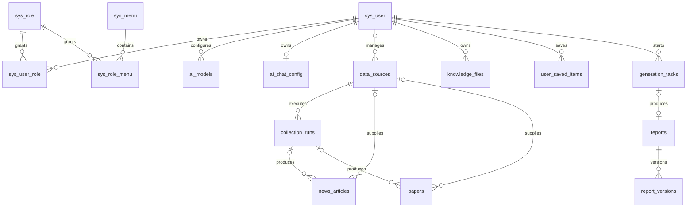

# PipeSight 全系统最终数据库设计（23 表实施版）

> 状态：最终实施基线  
> 最后复核：2026-08-17  
> 适用数据库：MySQL 8+、PostgreSQL 14+

## 1. 最终结论

PipeSight 最终使用 **23 张应用表**：

采集后的资讯和论文由 PipeSight 先落库，再交给 InsightHub 做领域、分类、Prompt、风险和向量处理。双方不合并表名；PipeSight 只在现有 `data_sources`、`collection_runs`、`news_articles`、`papers` 中增加 `handoff_*` 交接字段。详细契约见 [PipeSight-InsightHub 数据交接适配说明](../handover/PipeSight-InsightHub-数据交接适配说明.md)。

| 数据域 | 表数 | 职责 |
|---|---:|---|
| 账号与权限 | 5 | 用户、角色、菜单和 RBAC 授权 |
| 平台配置、日志与调度 | 7 | 参数、字典、登录/操作日志、定时任务 |
| AI 配置 | 2 | 用户级模型配置和对话偏好 |
| 采集与内容 | 4 | 数据源、采集运行、科技资讯、论文 |
| 知识与报告 | 5 | 知识文件、收藏/资料篮、生成任务、报告、报告版本 |
| **合计** | **23** | 当前产品能力的完整数据库基线 |

表数只用于校验文档、ORM、SQL 和迁移是否一致，不作为增加表的理由。任何新表必须同时具备明确产品能力、读写路径、数据生命周期和测试。

## 2. 明确移除的能力

### 2.1 平台模块

最终数据库不包含：

- `sys_dept`：不建设部门树；
- `sys_post`：不建设岗位字典；
- `sys_role_dept`：不支持部门或自定义部门数据范围；
- `sys_user_post`：用户不关联岗位；
- `sys_notice`：不建设站内通知公告；
- `gen_table`、`gen_table_column`：不保存在线代码生成配置。

同时移除：

- `sys_user.dept_id`；
- `sys_role.dept_check_strictly`；
- `ai_models.dept_id`；
- `knowledge_files.dept_id`。

数据权限只允许：

- `1`：全部数据；
- `5`：仅本人。

### 2.2 未进入最终基线的业务表

以下表不在最终 ORM 和初始化 SQL 中：

- `collection_records`；
- `taxonomy_terms`、`resource_terms`；
- `knowledge_chunks`；
- `report_templates`、`prompt_versions`；
- `generation_task_items`、`report_citations`；
- `report_exports`。

原因不是这些模型永远无价值，而是当前产品没有对应的完整读写、管理和检索闭环。需要相关能力时，应通过独立需求和迁移新增，不提前预建。

## 3. 通用规范

### 3.1 命名与主键

- 表名、字段名使用小写下划线；
- 若依平台表保留现有 `sys_*`、`ai_*` 名称；
- 平台数字主键使用 `BIGINT`；
- 业务可外显对象使用 `VARCHAR(64)` ID；
- 纯内部明细可使用自增 `BIGINT`；
- 关联表沿用若依复合主键，不额外增加无业务意义的代理键。

### 3.2 时间、字符集和时区

- MySQL 使用 `utf8mb4`；
- 服务端统一按约定时区写入，接口统一格式化；
- 业务表至少包含创建时间；可变聚合包含更新时间；
- 不同时混用 `del_flag`、`deleted_at` 和物理删除表达同一种生命周期。

### 3.3 JSON 使用原则

JSON 仅用于不需要独立关联查询的快照或扩展结构：

- 采集配置和断点；
- 文件标签、解析元数据；
- 任务输入、资料快照、阶段和日志；
- 报告章节、引用、质量问题和模型快照。

最终方案不再同时使用 JSON 和关系表保存同一事实：

- `generation_tasks.selected_items` 是任务资料的唯一快照；
- `reports.citations` 是当前报告引用的唯一事实；
- `report_versions.citations` 是历史版本引用的不可变事实。

### 3.4 状态和数值约束

稳定枚举及数值范围必须使用数据库 `CHECK`：

- 数据范围、账号状态和删除标志；
- 文件权限、解析状态；
- 收藏类型和动作；
- 任务、报告、采集状态；
- 进度 `0..100`、相关性 `0..100`；
- 计数和版本号不得为负数或零。

## 4. 平台数据库（14 张）

### 4.1 账号与权限（5 张）

| 表 | 主键 | 职责 | 关键约束 |
|---|---|---|---|
| `sys_user` | `user_id` | 登录账号和用户资料 | `user_name` 永久唯一 |
| `sys_role` | `role_id` | RBAC 角色 | `role_key`、`role_name` 永久唯一；`data_scope` 仅 `1/5` |
| `sys_menu` | `menu_id` | 目录、菜单、按钮和权限标识 | 父级、状态、权限标识索引 |
| `sys_user_role` | `(user_id, role_id)` | 用户—角色关系 | 两端删除均级联 |
| `sys_role_menu` | `(role_id, menu_id)` | 角色—菜单关系 | 两端删除均级联 |

`sys_user` 和 `sys_role` 使用若依软删除。被删除的用户名、角色编码和角色名称不允许复用；唯一性检查必须包含历史软删除记录，从而与数据库唯一约束一致。

内置账号只保留两类：`admin`（管理员，拥有全部后台权限）和 `common`（普通用户，只进入业务门户）。普通用户不写入若依后台菜单关联，避免在用户端出现系统管理、系统监控、系统工具和 AI 管理菜单；门户页面使用前端固定业务路由并统一经过登录鉴权。

### 4.2 配置、日志与调度（7 张）

| 表 | 主键 | 职责 | 关键约束 |
|---|---|---|---|
| `sys_config` | `config_id` | 系统参数 | `config_key` 唯一 |
| `sys_dict_type` | `dict_id` | 字典类型 | `dict_type` 唯一 |
| `sys_dict_data` | `dict_code` | 字典值 | `(dict_type, dict_value)` 唯一 |
| `sys_logininfor` | `info_id` | 登录日志 | 状态、时间索引 |
| `sys_oper_log` | `oper_id` | 管理端和业务操作审计 | 类型、状态、时间、操作人索引 |
| `sys_job` | `job_id` | 调度计划 | `(job_name, job_group)` 唯一 |
| `sys_job_log` | `job_log_id` | 调度执行历史 | 删除任务时 `job_id` 置空 |

业务审计复用 `sys_oper_log`；当前不创建通用 `audit_logs`。

### 4.3 AI 配置（2 张）

| 表 | 主键 | 职责 | 关键约束 |
|---|---|---|---|
| `ai_models` | `model_id` | 用户级供应商、模型参数和密钥密文 | `(user_id, provider, model_code)` 唯一 |
| `ai_chat_config` | `chat_config_id` | 用户级 AI 对话偏好 | `user_id` 唯一 |

- `ai_models.user_id` 非空，删除用户时级联删除其模型配置；
- `api_key` 只保存密文，接口返回必须脱敏；
- 当前不创建逐次调用流水表；任务过程记录在 `generation_tasks.logs`，报告版本记录最终模型快照。

## 5. 采集与内容数据库（4 张）

### 5.1 `data_sources`

职责：保存一个可执行的数据来源配置。

主要字段：

- `source_id`、唯一 `source_code`、`name`、`source_type`；
- `endpoint`、`adapter_key`、`schedule_cron`、`config_json`；
- `status`、`enabled`；
- 最近运行时间和状态、成功/失败计数；
- 可空负责人 `owner_id`；
- 创建、更新时间。

`status` 表示生命周期，`enabled` 表示执行开关。来源原则上通过停用保留历史，不通过软删除字段隐藏。

### 5.2 `collection_runs`

职责：保存一次手动、定时或重试采集运行。

主要字段：

- `run_id`、`source_id`、可空 `scheduler_job_id`；
- `trigger_type`、`status`；
- 配置快照、断点、开始/完成时间；
- 抓取、新增、更新、重复、失败数量；
- 错误信息、创建和更新时间。

来源删除使用 `RESTRICT`，调度任务删除后 `scheduler_job_id` 置空。

### 5.3 `news_articles`

职责：科技资讯和微信公众号文章的当前治理结果。

主要约束：

- `article_hash`、`url_hash` 分别唯一；
- `article_type` 仅 `news/wechat`；
- `relevance_score` 为 `0..100`；
- 来源和采集运行删除后外键置空，保留 `source_name` 快照；
- 标签和分析扩展使用 JSON。

### 5.4 `papers`

职责：论文元数据、摘要和合法全文状态。

主要约束：

- 规范化 DOI 唯一；
- 发表年份为空或不早于 1600；
- 引用次数不得为负；
- 作者结构、关键词、标签和扩展元数据使用 JSON；
- 来源和采集运行删除后外键置空。

## 6. 知识与报告数据库（5 张）

### 6.1 `knowledge_files`

职责：用户上传文件、解析结果和知识问答使用的全文。

主要约束：

- `permission_scope` 仅 `private/public`；
- `parse_status` 仅 `queued/parsing/indexed/failed`；
- 文件大小非负、版本号至少为 1；
- 所有者删除使用 `RESTRICT`；
- 删除资料时物理删除数据库记录和受控文件，同时清理对应 `user_saved_items`。

当前基础检索直接使用 `extracted_text`，没有实际切块/向量检索，因此不创建 `knowledge_chunks`。

### 6.2 `user_saved_items`

职责：收藏和资料篮。

- 唯一键：`(user_id, item_type, item_id, action)`；
- `item_type` 仅 `material/article/paper/report`；
- `action` 仅 `favorite/basket`；
- 多态目标不使用伪外键，服务层必须验证类型并在删除目标时清理对应记录；
- 用户删除时级联清理。

### 6.3 `generation_tasks`

职责：报告生成任务及其完整执行快照。

- `template_id` 是前端或代码内置模板编码快照，不关联不存在的模板表；
- `selected_items` 是任务启动时资料快照的唯一事实；
- `config`、`outline`、`stages`、`logs` 保存任务输入与过程；
- 进度限制在 `0..100`；
- 不保存 `report_id` 反向指针。

### 6.4 `reports`

职责：当前可编辑报告聚合。

- `source_task_id` 唯一，是任务—报告关系的唯一权威方向；
- 当前正文、章节、引用、质量问题和图形元数据在本表保存；
- 当前版本号至少为 1；
- 报告所有者删除使用 `RESTRICT`。

### 6.5 `report_versions`

职责：不可变报告历史版本。

- `(report_id, version_no)` 唯一；
- 报告删除时版本级联删除；
- 每个版本完整保存正文、章节、引用、质量问题和模型快照；
- 生成、重试、保存、发布、恢复均通过新增版本实现，不修改历史版本。

## 7. 关键关系

## 8. 删除策略

| 关系 | 策略 | 原因 |
|---|---|---|
| 用户 → 用户角色/收藏/AI 配置 | `CASCADE` | 纯用户附属配置 |
| 用户 → 知识文件/任务/报告 | `RESTRICT` | 必须先转移或明确清理业务资产 |
| 数据源 → 采集运行 | `RESTRICT` | 运行历史必须保留来源 |
| 数据源/运行 → 资讯、论文 | `SET NULL` | 内容继续保留，并使用来源名称快照 |
| 任务 → 报告 | `SET NULL` | 报告可独立保留 |
| 报告 → 报告版本 | `CASCADE` | 版本没有独立生命周期 |

## 9. 初始化与迁移

新数据库按数据库类型执行：

1. `ruoyi-fastapi.sql` 或 `ruoyi-fastapi-pg.sql`：14 张平台表及必要种子；
2. `pipeline-domain.sql` 或 `pipeline-domain-pg.sql`：5 张知识与报告表；
3. `pipeline-domain-enhancement.sql` 或 `pipeline-domain-enhancement-pg.sql`：4 张采集与内容表；
4. Alembic 升级到最新 head。

已有数据库迁移规则：

- 约束存在重复值或孤儿数据时迁移必须失败，不允许静默跳过；
- 菜单按 `path/perms/component` 稳定标识删除，不使用硬编码菜单 ID；
- 本轮曾预建的 9 张业务表只有在空表时才自动删除，存在数据时迁移失败并要求先归档；
- `contents`、`chunks`、`model_calls`、`audit_logs` 等更早期未知历史表不自动删除，需独立退役方案。

## 10. 实现映射

| 层 | 文件 |
|---|---|
| 最终设计 | `docs/plans/2026-08-14-full-system-database-design.md` |
| MySQL 平台初始化 | `backend/sql/ruoyi-fastapi.sql` |
| PostgreSQL 平台初始化 | `backend/sql/ruoyi-fastapi-pg.sql` |
| MySQL 业务初始化 | `backend/sql/pipeline-domain.sql`、`pipeline-domain-enhancement.sql` |
| PostgreSQL 业务初始化 | `backend/sql/pipeline-domain-pg.sql`、`pipeline-domain-enhancement-pg.sql` |
| 平台 ORM | `backend/module_admin/entity/do/`、`backend/module_ai/entity/do/` |
| 业务 ORM | `backend/module_pipeline/entity/do/pipeline_do.py` |
| DAO/Service | `backend/module_pipeline/dao/pipeline_dao.py`、`pipeline_domain_service.py` |
| 迁移 | `backend/alembic/versions/20260814_*.py` |
| 结构测试 | `backend/tests/test_pipeline_database_schema.py` |

## 11. 最终验收标准

1. ORM 必须且只注册 23 张应用表：平台 14 张、业务 9 张；
2. MySQL 和 PostgreSQL 初始化 SQL 创建同一组业务表；
3. 已移除平台表、部门字段和 9 张未实施业务表不得进入 ORM 或新库；
4. 每张业务表必须至少存在真实 DAO/Service 读或写路径；
5. 不允许同一事实同时由 JSON 和关系表共同充当权威来源；
6. 前端提交的模板编码不得依赖不存在的数据库种子；
7. 任务—报告关系只能由 `reports.source_task_id` 表达；
8. 数据范围、权限、状态和数值边界必须有数据库约束；
9. 迁移遇到重复、孤儿或待归档数据必须失败并给出原因；
10. SQLite 元数据建表、MySQL/PostgreSQL 离线迁移、Ruff 和相关测试全部通过。
