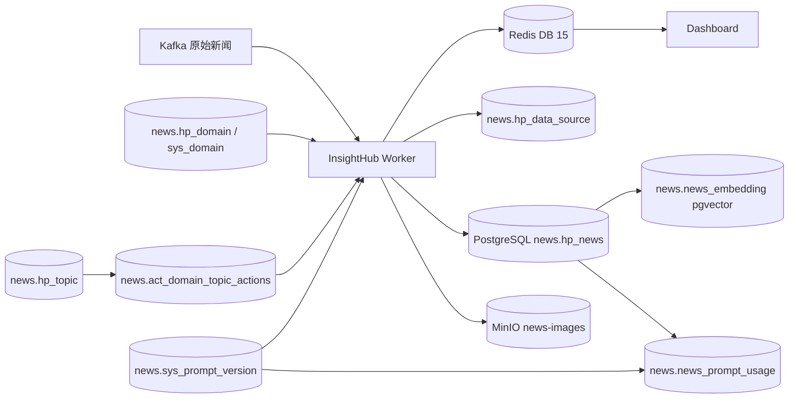

# InsightHub PostgreSQL 数据库完整交接文档

> 版本：2.0  
> 核验日期：2026-08-18  
> 目标数据库：`pipeline_news` / Schema `news`  
> 安全要求：本文不包含密码、Token、API Key、JWT Secret 或邮箱地址。敏感配置只通过 Secret/环境变量注入。

---

## 1. 交接摘要

### 1.1 当前结论

InsightHub 的目标数据库已经部署在 PostgreSQL：

```text
Host       172.16.4.166
Port       5432
Database   pipeline_news
Schema     news
Role       news_app
Version    PostgreSQL 18.4
Timezone   Asia/Shanghai
```

已完成：

- 新闻主表和热冷月分区保留；
- 领域、分类和数据源表迁移；
- Prompt 版本、父版本派生和新闻 Prompt 血缘；
- pgvector 1024 维向量表和 HNSW 索引；
- 应用角色权限；
- 全部 31 个 `news` Schema 对象的表级/字段级备注；
- 结构、约束、级联、权限和分区验证。

尚未完成：

- Worker PostgreSQL Adapter 切换；
- Worker 配置切换；
- MySQL/Milvus 历史数据回填与对账；
- PostgreSQL 恢复演练；
- 旧 `.env` 密钥轮换。

### 1.2 当前运行状态和目标状态

| 项目 | 当前运行状态 | 目标状态 |
|---|---|---|
| 新闻结构 | PostgreSQL 已准备 | PostgreSQL `news.hp_news` |
| 新闻写入代码 | 仍使用 MySQL Adapter | PostgreSQL Adapter |
| 领域配置代码 | 仍使用 MySQL Adapter | PostgreSQL `hp_domain/sys_domain` |
| Prompt 来源 | 文件/旧配置逻辑 | PostgreSQL `sys_prompt_version` |
| 向量写入代码 | 仍使用 Milvus Adapter | PostgreSQL `news_embedding` |
| Redis | 继续使用 | 继续使用 |
| MinIO | 继续使用 | 继续使用 |

不要因为 PostgreSQL 结构已存在就删除 MySQL/Milvus 配置；应用切换、回填、对账完成前，旧系统仍是迁移来源。

---

## 2. 存储拓扑



| 存储 | 当前状态 | 主要职责 |
|---|---|---|
| PostgreSQL | 目标库已部署 | 新闻、来源、领域、分类、Prompt 血缘、向量 |
| Redis | 保留 | 去重、锁、指标、告警、Dashboard 状态 |
| MinIO | 保留 | 图片、视频封面和其他对象 |
| MySQL | 迁移来源 | 当前 Worker 仍使用的新闻/领域配置库 |
| Milvus | 迁移来源 | 当前旧向量链路，切换后退出 |

---

## 3. PostgreSQL 连接和环境

### 3.1 连接参数

| 参数 | 值/规则 |
|---|---|
| Host | `172.16.4.166` |
| Port | `5432` |
| Database | `pipeline_news` |
| Schema | `news` |
| 应用角色 | `news_app` |
| 管理角色 | `postgres` |
| 时区 | `Asia/Shanghai`（UTC+8） |
| 认证 | SCRAM-SHA-256 |
| 热表空间 | `ts_hot` |
| 冷表空间 | `ts_cold` |
| PGDATA | `/home/pg_data/pgdata/data/` |
| 热表空间目录 | `/home/pg_data/pgdata/hot/` |
| 冷表空间目录 | `/home/pg_data/pgdata/cold/` |
| 备份目录 | `/home/pg_data/pgdata/backup/` |
| 容器 | `pg18-news` |

### 3.2 已启用扩展

| Extension | 版本 | Schema | 用途 |
|---|---:|---|---|
| `plpgsql` | 1.0 | `pg_catalog` | 函数和触发器 |
| `pg_partman` | 5.4.3 | `news` | 分区维护能力 |
| `vector` | 0.8.5 | `news` | pgvector 类型、距离运算和索引 |

`pg_cron` 在服务器镜像配置中存在；当前 `pipeline_news` 的 cron 调度状态需要运维单独确认。旧文档中的 `cron.database_name=newsdb` 不得直接用于当前数据库。

### 3.3 推荐应用变量

项目当前 `.env` 尚未切换 PostgreSQL。应用切换时新增：

```text
PG_HOST=172.16.4.166
PG_PORT=5432
PG_DATABASE=pipeline_news
PG_SCHEMA=news
PG_USER=news_app
PG_PASSWORD=<Secret>
PG_SSLMODE=require
```

或：

```text
PG_DSN=postgresql://news_app:<Secret>@172.16.4.166:5432/pipeline_news?options=-csearch_path%3Dnews
```

密码不得写入 Git、文档、日志或聊天记录。

---

## 4. 对象总览

2026-08-18 现场核验到 `news` Schema 共 31 个表/分区/View 对象，全部有表级备注，全部字段有字段备注。

### 4.1 InsightHub 业务对象

| 对象 | 类型 | 表空间 | 作用 |
|---|---|---|---|
| `hp_news` | 分区父表 | `ts_hot` | 新闻事实主表 |
| `hp_news_default` | 分区 | `ts_hot` | 新闻默认分区 |
| `hp_news_p20250701` ~ `hp_news_p20260101` | 月分区 | `ts_cold` | 历史冷新闻 |
| `hp_news_p20260201` ~ `hp_news_p20261201` | 月分区 | `ts_hot` | 热新闻月分区 |
| `hp_data_source` | 表 | `pg_default` | 来源/媒体主数据 |
| `hp_domain` | 表 | `pg_default` | 领域定义和动态配置 |
| `sys_domain` | View | `pg_default` | `hp_domain` 兼容读取入口 |
| `hp_topic` | 表 | `pg_default` | 分类树 |
| `act_domain_topic_actions` | 表 | `pg_default` | 领域—分类—Prompt 绑定 |
| `sys_prompt_version` | 表 | `pg_default` | Prompt 版本和派生树 |
| `news_prompt_usage` | 表 | `pg_default` | 新闻 Prompt 使用血缘 |
| `news_embedding` | 表 | `ts_hot` | 1024 维向量和检索快照 |

### 4.2 基础设施对象

| 对象 | 类型 | 作用 |
|---|---|---|
| `part_config` | 表 | pg_partman 父表维护配置 |
| `part_config_sub` | 表 | pg_partman 子分区维护配置 |
| `table_privs` | View | Schema 表权限审计 |

---

## 5. 新闻热冷分区

### 5.1 不变量

`news.hp_news` 是 PostgreSQL 原生 RANGE 分区表：

```text
主表：news.hp_news
分区键：create_time
主键：(news_id, create_time)
```

当前分区：

| 类型 | 数量 | 表空间 |
|---|---:|---|
| 月分区 | 19 | 12 个 `ts_hot`，7 个 `ts_cold` |
| 默认分区 | 1 | `ts_hot` |

现有月分区边界：

```text
2025-07 ~ 2026-02：ts_cold
2026-02 ~ 2027-01：ts_hot
默认分区：ts_hot
```

### 5.2 禁止操作

- 不得把 `hp_news` 改为普通表；
- 不得把分区键从 `create_time` 改为 `publish_time`；
- 不得创建不含 `create_time` 的主键/唯一约束；
- 不得删除、重建、合并、detach 历史分区；
- 不得把冷分区日常迁回 `ts_hot`；
- 修改父表索引后必须验证 19 个分区均继承；
- 向量表不参与新闻热冷迁移；
- Prompt 血缘和向量关联必须携带 `news_create_time`。

### 5.3 分区检查

```sql
SELECT
    child.relname AS partition_name,
    pg_get_expr(child.relpartbound, child.oid) AS partition_bound,
    COALESCE(ts.spcname, dts.spcname) AS tablespace
FROM pg_inherits i
JOIN pg_class parent ON parent.oid = i.inhparent
JOIN pg_namespace pn ON pn.oid = parent.relnamespace
JOIN pg_class child ON child.oid = i.inhrelid
LEFT JOIN pg_tablespace ts ON ts.oid = child.reltablespace
LEFT JOIN pg_database d ON d.datname = current_database()
LEFT JOIN pg_tablespace dts ON dts.oid = d.dattablespace
WHERE pn.nspname = 'news'
  AND parent.relname = 'hp_news'
ORDER BY child.relname;
```

---

## 6. 完整业务字段字典

字段备注以数据库 `pg_description` 为准；以下内容与当前实库一致。

### 6.1 `news.hp_news`

用途：处理后的新闻事实主表。正文永久保留，按 `create_time` 月分区。

| 字段 | 类型 | 可空 | 默认值 | 说明 |
|---|---|---|---|---|
| `news_id` | `bigint` | 否 | — | 新闻唯一标识符；与 `create_time` 组成主键 |
| `original_title` | `varchar(512)` | 是 | — | 新闻标题 |
| `original_text` | `text` | 是 | — | 新闻原文内容 |
| `translated_title` | `varchar(512)` | 是 | — | 新闻翻译标题 |
| `translated_text` | `text` | 是 | — | 新闻翻译内容 |
| `summary` | `text` | 是 | — | 新闻摘要或简短描述 |
| `author_id` | `bigint` | 是 | — | 新闻作者 ID，当前无作者表外键 |
| `web_source_id` | `bigint` | 是 | — | 新闻媒体 ID，逻辑关联 `hp_data_source` |
| `category_id` | `varchar(255)` | 是 | — | 原始新闻所属类别 ID |
| `favorites` | `integer` | 是 | `0` | 收藏次数 |
| `likes` | `integer` | 是 | `0` | 点赞次数 |
| `shares` | `integer` | 是 | `0` | 分享次数 |
| `bad` | `integer` | 是 | `0` | 不感兴趣次数 |
| `create_time` | `timestamp without time zone` | 否 | `CURRENT_TIMESTAMP` | 新闻创建时间和分区键 |
| `publish_time` | `timestamp without time zone` | 否 | — | 新闻发布时间 |
| `source` | `varchar(255)` | 是 | — | 新闻来源 |
| `cover_image_url` | `varchar(4096)` | 是 | — | 新闻封面 URL |
| `external_link` | `varchar(4096)` | 是 | — | 新闻外部链接 |
| `other_cn` | `text` | 是 | — | 中文扩展标签 |
| `other` | `text` | 是 | — | 扩展字段，Worker 可写入 JSON |
| `is_featured` | `smallint` | 是 | `0` | 是否推荐 |
| `del_flag` | `char(1)` | 是 | `0` | 删除标志：0 存在、2 删除 |
| `tags` | `text` | 是 | — | 其他标签 |
| `news_all_info` | `text` | 是 | — | 全部原始新闻信息 |
| `timestamp` | `timestamp without time zone` | 是 | — | 原有创建时间戳 |
| `filter_result` | `text` | 是 | — | 新闻过滤处理结果或说明 |
| `warning_cause` | `varchar(500)` | 是 | — | 预警原因 |
| `background` | `text` | 是 | — | 相关背景 |
| `focus_risk` | `varchar(500)` | 是 | — | 提请关注风险 |
| `suggestion` | `text` | 是 | — | 对策建议 |
| `warning_grade` | `varchar(255)` | 是 | — | 预警等级 |
| `url` | `varchar(255)` | 是 | — | 新闻链接 |
| `is_top` | `char(1)` | 是 | — | 是否置顶 |
| `type` | `char(10)` | 是 | — | 新闻类型 |
| `judgment_opinion` | `text` | 是 | — | 研判意见 |
| `classify` | `integer` | 是 | — | 处理后的分类 ID，逻辑关联 `hp_topic.category_id` |
| `uuid` | `varchar(255)` | 是 | — | 上游业务新闻标识，不保证唯一 |
| `score` | `real` | 是 | — | 预警分数 |
| `ai_title` | `text` | 是 | — | AI 标题 |
| `domain_id` | `bigint` | 是 | — | 领域 ID，逻辑关联 `hp_domain` |
| `domain` | `varchar(255)` | 是 | — | 领域名称 |
| `platform` | `integer` | 是 | — | 平台标识，1 表示微信 |
| `content_extraction` | `text` | 是 | — | 新闻内容提取结果 |
| `event_keywords` | `text` | 是 | — | 新闻搜索关键词 |
| `prompt_trace_id` | `varchar(26)` | 是 | — | Prompt 处理血缘批次 ULID |

关键索引：

```text
hp_news_pkey
hp_news_idx_uuid_idx
hp_news_idx_title_idx
hp_news_normal_web_source_id_idx
hp_news_idx_domain_id_idx
hp_news_idx_classify_idx
hp_news_idx_publish_time_idx
hp_news_idx_score_idx
hp_news_idx_source_domain_idx
hp_news_idx_hp_news_domain_del_pub_news_idx
hp_news_idx_hp_news_domain_classify_del_pub_news_idx
hp_news_prompt_trace_idx
```

### 6.2 `news.hp_data_source`

| 字段 | 类型 | 可空 | 默认值 | 说明 |
|---|---|---|---|---|
| `web_source_id` | `bigint` | 否 | — | 来源主键 |
| `web_name` | `varchar(255)` | 否 | — | 网站/媒体名称，唯一 |
| `web_name_cn` | `varchar(255)` | 是 | — | 中文名称 |
| `url` | `varchar(512)` | 否 | — | 来源 URL |
| `description` | `text` | 是 | — | 来源描述 |
| `category` | `char(1)` | 是 | — | 数据源分类标识 |
| `logo_path` | `varchar(512)` | 是 | — | Logo 文件路径 |
| `logo_url` | `varchar(512)` | 是 | — | Logo URL |
| `content_type` | `varchar(5)` | 是 | — | HTML、RSS、JSON 等内容类型 |
| `authentication_required` | `char(1)` | 是 | `0` | 是否需要认证 |
| `last_crawled_timestamp` | `timestamp without time zone` | 是 | — | 最后抓取时间 |
| `next_crawl_priority` | `char(1)` | 是 | `0` | 抓取优先级 |
| `is_crawled` | `char(1)` | 是 | `0` | 是否完成抓取 |
| `other` | `json` | 是 | — | JSON 扩展字段 |
| `create_by` | `varchar(255)` | 是 | — | 创建人 |
| `create_time` | `timestamp without time zone` | 是 | — | 创建时间 |
| `remark` | `text` | 是 | — | 备注 |
| `data_source_classify` | `char(1)` | 是 | — | 1 数据源、2 机构 |
| `tag` | `varchar(1000)` | 是 | — | 标签 |

### 6.3 `news.hp_domain`

| 字段 | 类型 | 可空 | 默认值 | 说明 |
|---|---|---|---|---|
| `domain_id` | `bigint` | 否 | — | 领域主键 |
| `domain_name` | `varchar(255)` | 是 | — | 领域名称 |
| `remark` | `varchar(2000)` | 是 | — | 领域备注 |
| `user_id` | `bigint` | 是 | — | 用户 ID |
| `create_time` | `timestamp without time zone` | 是 | — | 创建时间 |
| `create_by` | `varchar(255)` | 是 | — | 创建人 |
| `other` | `varchar(255)` | 是 | — | 扩展字段 |
| `del_flag` | `char(1)` | 是 | `0` | 0 有效、2 删除 |
| `update_time` | `timestamp without time zone` | 是 | — | 修改时间 |
| `update_by` | `varchar(255)` | 是 | — | 修改人 |
| `filter_prompts` | `text` | 是 | — | 领域过滤提示词兼容字段 |
| `score_prompts` | `text` | 是 | — | 领域评分提示词兼容字段 |
| `return_flag` | `integer` | 是 | `0` | 处理器类型；0 为本地处理器 |

### 6.4 `news.sys_domain` View

`sys_domain` 不保存数据，直接读取 `news.hp_domain`。

| 字段 | 类型 | 说明 |
|---|---|---|
| `domain_id` | `bigint` | 领域 ID |
| `domain_name` | `varchar(255)` | 领域名称 |
| `remark` | `varchar(2000)` | 领域备注 |
| `user_id` | `bigint` | 用户 ID |
| `create_time` | `timestamp without time zone` | 创建时间 |
| `create_by` | `varchar(255)` | 创建人 |
| `other` | `varchar(255)` | 扩展字段 |
| `del_flag` | `char(1)` | 删除标志 |
| `update_time` | `timestamp without time zone` | 修改时间 |
| `update_by` | `varchar(255)` | 修改人 |
| `filter_prompts` | `text` | 过滤提示词 |
| `score_prompts` | `text` | 评分提示词 |
| `return_flag` | `integer` | 处理器类型 |

### 6.5 `news.hp_topic`

| 字段 | 类型 | 可空 | 默认值 | 说明 |
|---|---|---|---|---|
| `category_id` | `bigint` | 否 | — | 分类主键 |
| `category_name` | `varchar(255)` | 否 | — | 分类名称 |
| `category_description` | `text` | 是 | — | 分类详细描述 |
| `create_time` | `timestamp without time zone` | 是 | `CURRENT_TIMESTAMP` | 创建时间 |
| `create_by` | `varchar(255)` | 是 | — | 创建人 |
| `update_time` | `timestamp without time zone` | 是 | — | 最后更新时间 |
| `parent_category_id` | `bigint` | 是 | — | 父分类 ID |
| `ancestors` | `varchar(255)` | 是 | — | 祖先路径 |
| `is_active` | `char(1)` | 是 | `0` | 0 启用、1 禁用 |
| `sort_order` | `integer` | 是 | — | 排序顺序 |
| `del_flag` | `char(1)` | 是 | `0` | 0 存在、2 删除 |
| `remark` | `text` | 是 | — | 备注 |
| `other` | `json` | 是 | — | 扩展 JSON |
| `return_flag` | `integer` | 是 | `0` | 分类处理返回标志 |
| `domain_id` | `integer` | 是 | — | 分类对应领域 ID |
| `update_by` | `varchar(255)` | 是 | — | 最后修改人 |

### 6.6 `news.act_domain_topic_actions`

| 字段 | 类型 | 可空 | 默认值 | 说明 |
|---|---|---|---|---|
| `domain_id` | `bigint` | 否 | — | 领域 ID |
| `category_id` | `bigint` | 否 | — | 分类 ID |
| `category_prompts` | `text` | 是 | — | 迁移兼容字段；切换完成后删除 |
| `prompt_version_id` | `bigint` | 是 | — | 分类标准 Prompt 版本 ID |
| `created_at` | `timestamptz` | 否 | `now()` | 绑定创建时间 |
| `updated_at` | `timestamptz` | 否 | `now()` | 绑定更新时间 |

主键：`(domain_id, category_id)`。约束：`category_prompts` 与 `prompt_version_id` 至少一个非空。

### 6.7 `news.sys_prompt_version`

| 字段 | 类型 | 可空 | 默认值 | 说明 |
|---|---|---|---|---|
| `prompt_version_id` | `bigint` | 否 | Identity | Prompt 版本主键 |
| `parent_prompt_version_id` | `bigint` | 是 | — | 直接派生父版本；可跨 `prompt_key` |
| `prompt_key` | `varchar(150)` | 否 | — | 稳定业务键 |
| `prompt_name` | `varchar(255)` | 否 | — | 展示名称 |
| `prompt_type` | `varchar(50)` | 否 | — | FILTER、CLASSIFY、SCORE、WARNING 等 |
| `domain_id` | `bigint` | 是 | — | 适用领域；空为全局 |
| `category_id` | `bigint` | 是 | — | 适用分类；空为非分类专属 |
| `version_no` | `integer` | 否 | — | 同 key 递增版本号 |
| `system_prompt` | `text` | 否 | `''` | System Prompt 模板 |
| `user_prompt` | `text` | 否 | — | User Prompt 模板 |
| `template_variables` | `jsonb` | 是 | — | 模板变量清单 |
| `content_hash` | `char(64)` | 否 | — | Prompt 内容 SHA-256 |
| `status` | `varchar(20)` | 否 | `draft` | draft/published/retired |
| `derivation_note` | `varchar(1000)` | 是 | — | 派生说明 |
| `created_by` | `varchar(255)` | 是 | — | 创建人 |
| `created_at` | `timestamptz` | 否 | `now()` | 创建时间 |
| `updated_at` | `timestamptz` | 否 | `now()` | 最后修改时间 |
| `published_at` | `timestamptz` | 是 | — | 发布时间 |

关键约束：

- `(prompt_key, version_no)` 唯一；
- `(prompt_key, content_hash)` 唯一；
- 同一 `prompt_key` 最多一个 `published`；
- 父版本外键禁止删除父节点；
- 已发布或已使用版本由 Trigger 保护不可修改；
- 自指被 CHECK 拒绝，长环由发布流程递归检查。

### 6.8 `news.news_prompt_usage`

| 字段 | 类型 | 可空 | 默认值 | 说明 |
|---|---|---|---|---|
| `usage_id` | `bigint` | 否 | Identity | 使用记录主键 |
| `prompt_trace_id` | `varchar(26)` | 否 | — | 新闻 Prompt 血缘 ULID |
| `news_id` | `bigint` | 否 | — | 新闻 ID |
| `news_create_time` | `timestamp without time zone` | 否 | — | 新闻分区键 |
| `prompt_version_id` | `bigint` | 否 | — | 实际使用 Prompt 版本 |
| `stage` | `varchar(50)` | 否 | — | FILTER、CLASSIFY、SCORE 等阶段 |
| `sequence_no` | `integer` | 否 | — | 本次处理顺序 |
| `model_name` | `varchar(255)` | 是 | — | 实际模型 |
| `created_at` | `timestamptz` | 否 | `now()` | 记录时间 |

外键：

```text
(prompt_trace_id, news_id, news_create_time)
    → hp_news(prompt_trace_id, news_id, create_time)
prompt_version_id
    → sys_prompt_version(prompt_version_id)
```

### 6.9 `news.news_embedding`

| 字段 | 类型 | 可空 | 默认值 | 说明 |
|---|---|---|---|---|
| `news_id` | `bigint` | 否 | — | 新闻 ID，复合主键第一列 |
| `news_create_time` | `timestamp without time zone` | 否 | — | 新闻分区键，复合主键第二列 |
| `uuid` | `varchar(255)` | 否 | — | UUID 快照，不唯一 |
| `embedding` | `news.vector(1024)` | 否 | — | 1024 维语义向量，cosine 距离 |
| `embedding_model` | `text` | 否 | — | Embedding 模型 |
| `embedding_version` | `integer` | 否 | `1` | 输入规则版本 |
| `source_hash` | `char(64)` | 否 | — | 输入文本 SHA-256 |
| `domain_id` | `bigint` | 是 | — | 领域过滤投影 |
| `category_id` | `bigint` | 是 | — | 分类过滤投影 |
| `published_at` | `timestamp without time zone` | 是 | — | 发布时间过滤投影 |
| `key_words` | `text` | 否 | `''` | 关键词快照 |
| `title` | `varchar(512)` | 否 | — | 标题快照 |
| `ai_title` | `text` | 否 | `''` | AI 标题快照 |
| `source` | `varchar(255)` | 是 | — | 来源快照 |
| `domain` | `varchar(255)` | 是 | — | 领域名称快照 |
| `external_link` | `varchar(4096)` | 是 | — | 外链快照 |
| `cover_image_url` | `varchar(4096)` | 是 | — | 封面快照 |
| `producer` | `varchar(100)` | 否 | `insight_hub` | 生产者标识 |
| `created_at` | `timestamptz` | 否 | `now()` | 创建时间 |
| `updated_at` | `timestamptz` | 否 | `now()` | 最后修改时间 |

主键：`(news_id, news_create_time)`。外键指向 `hp_news(news_id, create_time)`，删除新闻自动删除向量。

---

## 7. 权限

### 7.1 `news_app`

已核验：

- 可连接 `pipeline_news`；
- 有 `news` Schema `USAGE`；
- 不能创建 Schema 对象；
- 对 19 个新闻分区、基础表、Prompt 表和向量表拥有 `SELECT/INSERT/UPDATE/DELETE`；
- 对 `sys_domain` 和 `table_privs` 拥有查询权限；
- 6 个 Identity/业务序列具备 `USAGE/SELECT`；
- 无超级用户、建库、建角色和 cron 管理权限。

### 7.2 `postgres`

只用于迁移、扩展、索引、分区、备份、恢复和授权。应用不得使用 `postgres`。

---

## 8. Redis 和 MinIO

### 8.1 Redis

```text
Host：127.0.0.1
Port：6379
Database：15
Password：REDIS_PASSWORD
```

主要键：

| 键模式 | 用途 | TTL/保留 |
|---|---|---|
| `news_hash:{simhash}` | 新闻去重 | 30 天 |
| `title:{title}` | 标题到领域缓存 | 30 天 |
| `worker:metrics:{worker_id}` | Worker 指标 | 60 秒 |
| `worker:failures:{worker_id}` | Worker 失败记录 | 300 秒 |
| `alert:config:global` | 全局告警配置 | 无固定 TTL |
| `alert:config:history` | 告警历史 | 最多 100 条 |
| `cluster:metrics:history` | Dashboard 集群历史 | 3 天 |
| `dashboard:token:blacklist:{jti}` | JWT 黑名单 | 至 Token 过期 |

Redis 不保存新闻正文和永久事实。

### 8.2 MinIO

```text
Endpoint：172.16.4.181:9000
Bucket：news-images
Secure：False（当前配置）
```

Access Key/Secret Key 通过 Secret 注入。MinIO 保存图片和封面，不保存关系型元数据。

---

## 9. MySQL/Milvus 迁移来源

当前 `.env` 仍包含：

```text
MYSQL_URL / MYSQL_DB / NEWS_TABLE_NAME
DOMAIN_CONFIG_MYSQL_URL / DOMAIN_CONFIG_MYSQL_DB
MILVUS_CLUSTER_ENDPOINT / MILVUS_COLLECTION_NAME
```

这些是迁移来源，不是目标数据库结构。当前 Worker 代码仍使用 `news_processor/db/mysql.py` 和 `news_processor/db/milvus.py`，因此切换前：

1. 不删除 MySQL/Milvus 配置；
2. 不删除源数据；
3. 先实现 PostgreSQL Adapter；
4. 先完成双写/回填和对账；
5. 再切断旧库写入；
6. 最后保留只读窗口后下线旧连接。

MySQL 源库中的用户行为、报告、素材、法律、标准、专利、追踪等表不在当前 InsightHub 迁移边界内。

---

## 10. 备份和恢复

### 10.1 逻辑备份

```bash
cd /home/pg_data/pg18-docker
BACKUP_TS=$(date -u +%Y%m%dT%H%M%SZ)

sudo docker compose exec -T postgres \
  pg_dump -U postgres -d pipeline_news \
  --schema=news \
  --format=custom \
  --file="/backup/pipeline_news-news-${BACKUP_TS}.dump"

sudo docker compose exec -T postgres \
  pg_dumpall -U postgres --globals-only \
  > "/home/pg_data/pgdata/backup/globals-${BACKUP_TS}.sql"
```

### 10.2 恢复顺序

1. 恢复角色；
2. 创建表空间；
3. 创建 `pipeline_news`；
4. 创建 `news` Schema 和扩展；
5. 恢复 `hp_news` 父表及 19 个分区；
6. 恢复基础配置表；
7. 恢复 Prompt 表和血缘；
8. 恢复向量表和 HNSW 索引；
9. 恢复权限、触发器和 View；
10. 验证分区、外键、备注和向量维度；
11. 最后开放 `news_app` 流量。

### 10.3 恢复后检查

```sql
SELECT current_database(), current_user, current_setting('TimeZone');

SELECT extname, extversion
FROM pg_extension
WHERE extname IN ('pg_partman', 'vector');

SELECT count(*) FROM news.news_embedding;
SELECT count(*) FROM news.news_prompt_usage;
SELECT min(news.vector_dims(embedding)), max(news.vector_dims(embedding))
FROM news.news_embedding;
```

---

## 11. 日常检查和故障处理

### 11.1 每日检查

- PostgreSQL 连通性和认证；
- `hp_news_default` 是否意外增长；
- 月分区是否提前创建；
- 热冷表空间是否正确；
- `news_app` 权限是否未扩大；
- 向量维度是否始终为 1024；
- Prompt 同一 key 是否多于一个 published；
- 新闻是否有血缘入口但无明细；
- 备份文件是否产生且可读取；
- Redis 指标/失败记录 TTL 是否正常。

### 11.2 默认分区增长

默认分区有数据通常表示：

- 月分区没有提前创建；
- `create_time` 不在预期范围；
- 分区边界配置错误。

处理顺序：先停止错误写入或确认数据来源，检查分区边界，再由管理员创建/修正分区；不得直接删除默认分区数据。

### 11.3 向量写入失败

检查：

1. `news.vector` Extension 是否存在；
2. 向量维度是否为 1024；
3. `news_app` 是否有 `news_embedding` DML；
4. `(news_id, news_create_time)` 是否对应新闻分区行；
5. Embedding Endpoint 是否返回正确模型和维度；
6. HNSW 索引是否存在；
7. `source_hash` 是否发生变化。

### 11.4 Prompt 版本异常

检查：

```sql
SELECT prompt_key, count(*)
FROM news.sys_prompt_version
WHERE status = 'published'
GROUP BY prompt_key
HAVING count(*) > 1;

SELECT prompt_version_id, parent_prompt_version_id
FROM news.sys_prompt_version
WHERE prompt_version_id = parent_prompt_version_id;
```

已发布或已使用 Prompt 不得直接 UPDATE 内容；必须 INSERT 新版本。

---

## 12. 应用迁移完成判定

以下条件全部满足，才能宣布应用迁移完成：

- Worker 使用 `pipeline_news.news`；
- 新闻进入正确 `hp_news` 月分区；
- 来源、领域、分类读取正常；
- Prompt 从 `sys_prompt_version` 加载；
- 新闻写入 `prompt_trace_id` 和 `news_prompt_usage`；
- 向量写入 `news_embedding`，维度 1024；
- HNSW 查询正常；
- 新闻删除时向量和血缘级联；
- Redis/MinIO 正常；
- MySQL/Milvus 不再接收新写入；
- 完成备份恢复演练；
- 完成密钥轮换；
- 完成最终对账。

---

## 13. 文件索引

| 文件 | 用途 |
|---|---|
| `docs/数据库交接方案.md` | 本完整交接文档 |
| `docs/数据库设计/数据库设计.md` | 当前数据库设计和实体关系 |
| `docs/数据库设计/04_pipeline_news_pg_migration.sql` | PostgreSQL 结构迁移事实源 |
| `docs/数据库设计/02_pgvector_operations.sql` | pgvector 实际操作契约 |
| `docs/数据库设计/05_pg_column_comments.sql` | 新增对象字段备注迁移 |
| `docs/数据库设计/06_pg_all_column_comments.sql` | 全 Schema 表/分区/View 字段备注迁移 |
| `docs/166_pg环境文档.md` | 166 服务器环境和 PostgreSQL 部署资料 |
| `.env` | 当前 Worker 配置；仍含旧 MySQL/Milvus 配置 |
| `news_processor/db/mysql.py` | 旧 MySQL Adapter，待切换 |
| `news_processor/db/milvus.py` | 旧 Milvus Adapter，待切换 |
| `news_processor/db/redis.py` | Redis Adapter |
| `news_processor/db/minio.py` | MinIO Adapter |

---

## 14. 当前交接状态

```text
[完成] PostgreSQL 连接和权限核验
[完成] pipeline_news.news Schema
[完成] hp_news 热冷月分区保留
[完成] 9 个 InsightHub 核心业务对象
[完成] 19 个新闻分区表空间核验
[完成] Prompt 版本、派生和新闻血缘
[完成] pgvector 1024 维向量表和 HNSW
[完成] 外键、约束、触发器和级联冒烟
[完成] news_app 权限和序列权限
[完成] 31 个对象表级/字段级备注
[完成] 数据库对象完整性差集核验
[待办] PostgreSQL 应用 Adapter
[待办] 应用配置切换
[待办] MySQL/Milvus 数据回填和对账
[待办] PostgreSQL 备份恢复演练
[待办] 密钥轮换
```
